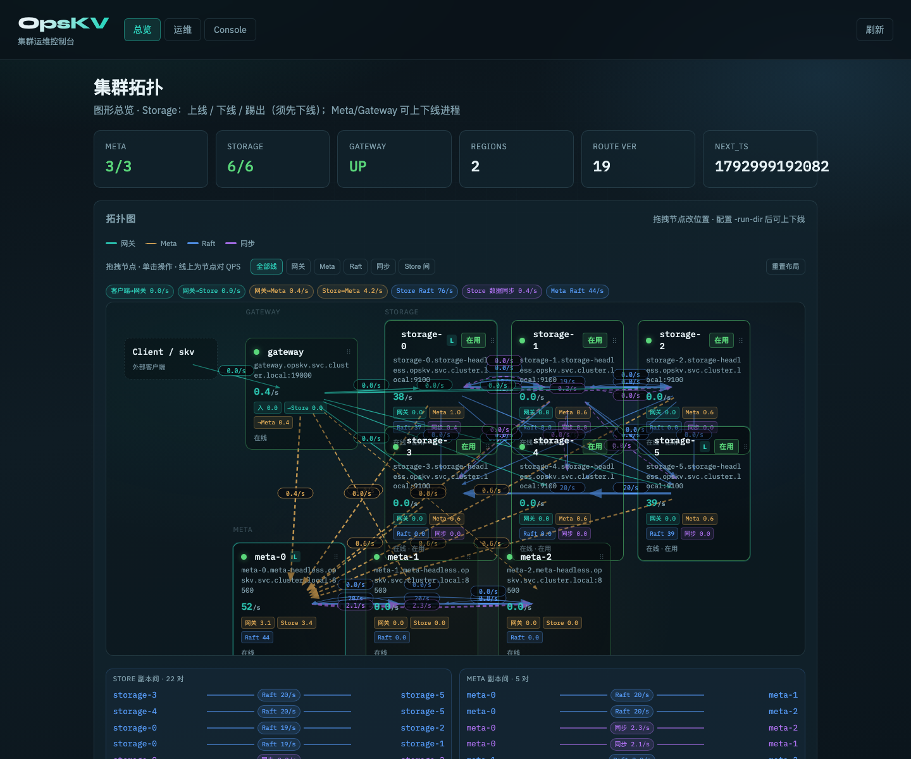

# OpsKV

基于 **Multi-Raft + RocksDB + gRPC** 的存算分离分布式 KV（C++ Meta/Storage + Go Gateway/客户端）。分片为 **Range Region**，默认副本因子 3。

**License:** [Apache License 2.0](LICENSE) · Copyright 2026 devotionalist（见 [NOTICE](NOTICE)）

## 架构一览

```
Go Client / skv
      │ gRPC :19000
      ▼
Compute Gateway (Go, 无状态)  ←── GET_ROUTE / LOCATE ──→  Meta Raft ×3 (:8500–8502)
      │ Storage TCP
      ▼
Storage ×3 (:9100–9102)  · 每 Region 一组 Raft (RF=3) · RocksDB
```

| 组件 | 职责 |
|------|------|
| **compute-gateway** | 无状态：Range 路由、Leader 缓存、重试 |
| **storage** | 有状态：Multi-Raft + RocksDB；`ADMIN_SPLIT` / `ADMIN_MERGE` |
| **meta** | Region 表、拓扑、分裂/合并/扩容编排；**Raft 3 副本 HA** |
| **client/go** | gRPC SDK |
| **tools/skv** | C++ 运维 CLI（启停、put/get、locate/split/merge） |
| **web/** | 独立 Web 管控模块（`:19100`）：拓扑 / Region / 运维 / KV |



**用户手册：** [docs/USER_GUIDE.md](docs/USER_GUIDE.md) · [docs/](docs/)

## 快速开始（本地 stub）

不依赖 Seastar / gRPC C++ 也可跑通（Storage 捆绑 RocksDB；进程分配器默认 **jemalloc** FetchContent；Meta/Storage TCP + Go gRPC 网关）：

```bash
make          # configure + build + unit tests
make e2e      # 编译 → 启集群 → Go 客户端 → 停集群
```

或用 skv：

```bash
cmake --build build -j --target skv
./build/tools/skv start --fresh
./build/tools/skv put hello world
./build/tools/skv get hello
./build/tools/skv locate hello
./build/tools/skv route
./build/tools/skv stop
```

Make 封装：

```bash
make cluster-up      # gateway 默认 :19000
make cluster-test
make admin-run       # http://127.0.0.1:19100 可视化运维
make cluster-down
# 或：SKV_ADMIN=1 make cluster-up   # 集群启动时一并拉起管控台
```

客户端：

```bash
./.run/kv-example 127.0.0.1:19000
cd client/go && go run ./examples/e2e -addr 127.0.0.1:19000
```

可选完整依赖（网络栈 [scylladb/seastar](https://github.com/scylladb/seastar) 经 **FetchContent** 编进工程，同 RocksDB；**建议在 Linux**；macOS 默认 OFF）：

```bash
# 系统依赖（boost/hwloc/…）只需装一次
sudo ./path/to/seastar/install-dependencies.sh

cmake -B build \
  -DOPSKV_USE_SEASTAR=ON \
  -DOPSKV_USE_GRPC=ON
# 可选钉版本：-DOPSKV_SEASTAR_GIT_TAG=seastar-25.05.0
cmake --build build -j
```

**gRPC 强制**（KV / Meta / Admin / Raft）。优先系统 Protobuf/gRPC；否则 FetchContent 拉 `grpc`（首次较慢）。

## Kubernetes

见用户手册 [§3 Kubernetes / Helm](docs/USER_GUIDE.md#3-kubernetes--helm-部署) 与 [§4 扩容](docs/USER_GUIDE.md#4-扩容加节点--加入集群)。

## Go 客户端

```bash
make proto
cd client/go && go mod tidy
go run ./examples/basic 127.0.0.1:19000
```

```go
cli, _ := kv.Dial(ctx, "127.0.0.1:19000")
cli.Put(ctx, []byte("k"), []byte("v"))
val, found, rev, _ := cli.Get(ctx, []byte("k"))
```

## 目录

```
proto/      gRPC 定义
common/    配置、Region、日志
raft/      Multi-Raft
storage/   RocksDB + Storage Node
meta/      集群状态 + Scaler
client/go/ Go SDK + gateway
tools/skv/ 运维 CLI
web/       管控台
docs/      用户文档
deploy/    Docker / Helm
conf/      本地配置
```

## 许可证

本项目采用 [Apache License 2.0](http://www.apache.org/licenses/LICENSE-2.0) 开源。完整文本见仓库根目录 [LICENSE](LICENSE)；版权归属见 [NOTICE](NOTICE)。

自有源码（C++/Go/TS/proto、脚本与 CMake 等）文件头含 Apache 附录推荐的版权与许可声明（`Copyright 2026 devotionalist`）。构建产物（如 `web/static/`、`*/gen/`）与第三方依赖不另加本声明，仍受其各自许可证约束。

版权仍属于版权所有者；Apache-2.0 仅授予使用、修改与再分发等许可，不转让所有权。
