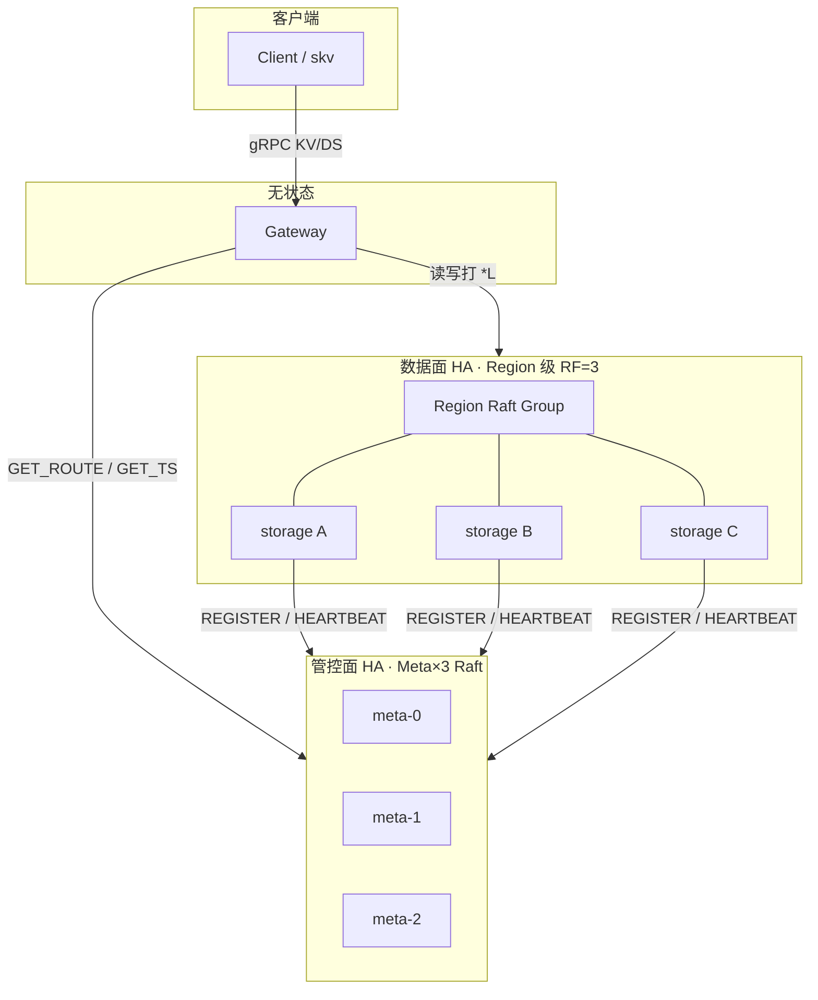
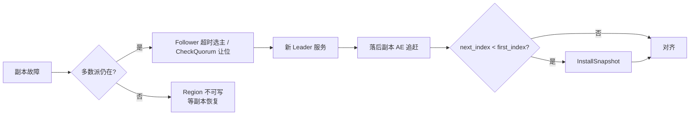

# 数据高可用设计

**状态：** 设计总览（与实现对齐）  
**读者：** 架构 / 运维 / 发版验收  
**相关：** [ARCHITECTURE.md](ARCHITECTURE.md) · [MULTI_RAFT_PRODUCTION.md](../production/MULTI_RAFT_PRODUCTION.md) · [META_PRODUCTION.md](../production/META_PRODUCTION.md) · [FAULT_DRILL.md](../ops/FAULT_DRILL.md)

---

## 1. 问题与目标

OpsKV 把「数据是否丢、是否可写」与「管控面是否还能调度」拆成两套独立共识：

| 面 | 单元 | 冗余 | 丢失 1 副本时 |
|----|------|------|----------------|
| **数据面** | 每个 Region 一组 Multi-Raft | 默认 **RF=3**，多数派 = 2 | 仍可选主、读写 |
| **管控面** | Meta 单 Raft Group（`kMetaShard=0`） | **Meta×3**，多数派 = 2 | 路由 / TSO / 注册仍可用 |

**目标（可验收）：**

1. 任意 **单** Storage 宕机：该 Region 其余多数派继续服务；Gateway 经 `not_leader` 切 Leader。
2. 任意 **单** Meta 宕机：数据面不中断；`GET_ROUTE` / TSO 仍可达。
3. 进程崩溃再启：WAL / Raft 日志装载；落后则 AE，日志窗口外则 Snapshot。
4. 丢 **同 Region 2/3 副本** 或 **2/3 Meta**：预期**不可写 / 管控不可用**，恢复多数派后追齐——不承诺脑裂写。

非目标：进程被 kill 后**自动拉起**（靠 k8s / `skv restart` / 演练脚本）；跨机房 RF=5 的生产调优（见 Multi-Raft 生产文档差距表）。

---

## 2. 逻辑模型

- **Gateway** 无本地用户数据；挂掉只影响入口，不丢盘上 KV。
- **同一物理 Store** 可承载多个 Region 的副本；HA 粒度是 **Region Raft Group**，不是「整机三副本镜像」。
- 开机默认：**Region 0** 覆盖全 key 空间，副本落在前 RF 个 Storage；其余 Store 可 Joining → join → balance 再持副本。

---

## 3. 数据面：Region Multi-Raft

### 3.1 写 / 读与多数派

| 路径 | 行为 | 一致语义 |
|------|------|----------|
| 写 | 仅 **Leader** propose → `RAFT_AE` → 多数派 commit → 各副本 Apply RocksDB | 强一致 |
| 线性读 | 默认仅 Leader（+ TSO/MVCC） | 强一致 |
| 副本读 | `linearizable=false` 可读任意副本本地快照 | 可能落后 |

提交规则（`maybe_commit`）：取各 voter `match_index` 的第 `majority` 大者，且 entry.term == 当前 term。详见 [flows/06-raft-election-commit.md](../flows/06-raft-election-commit.md)。

### 3.2 故障与恢复

| 机制 | 说明 | 流程文档 |
|------|------|----------|
| 选举 / 心跳 / CheckQuorum | 同一套 `RaftNode`；联系不到多数派则 Leader 让位 | [06-raft-election-commit.md](../flows/06-raft-election-commit.md) |
| WAL 装载 | `hard.state` + `log.entries` → `recover_apply` | [04-fault-recovery.md](../flows/04-fault-recovery.md) · [07-storage-startup.md](../flows/07-storage-startup.md) |
| Snapshot | compact 后 AE 无法对齐 → `RAFT_SNAP` + `KvEngine::{create,apply}_snapshot` | 同上 |
| 客户端切主 | Storage 回 `not_leader redirect=`；Gateway `rememberLeader` 重试 | [08-not-leader-redirect.md](../flows/08-not-leader-redirect.md) |
| 存活与调度 | HB 超时 → Meta 标 `Offline`，`suggest_placement` 排除 | [05-meta-ha.md](../flows/05-meta-ha.md) |

### 3.3 与扩缩容的关系（副本可用性）

| 操作 | 对 HA 的影响 |
|------|----------------|
| Helm / 加 Pod | 仅 **Joining**，**未持副本**，不抬 RF |
| 运维 join + balance / place | ConfChange Learner→Voter + Snapshot；路由发布后才算进多数派 |
| `SCALE_OUT`（抬 RF） | 另路径；默认加节点**不是**抬 RF |
| scale-in / Drain | Draining 迁走副本 → Tombstone；**迁完前勿杀进程** |

设计与 SOP：[扩容缩容设计.md](../flows/扩容缩容设计.md) · [K8S_SCALE.md](../flows/K8S_SCALE.md) · [10-region-placement.md](../flows/10-region-placement.md)。

### 3.4 能力边界（数据面）

| 能力 | 自动？ |
|------|--------|
| 单副本宕机后选主、AE/Snapshot 追赶 | 是（进程仍在多数派拓扑内） |
| Gateway 刷路由 / 跟 redirect | 是 |
| 进程被 kill 后自动拉起 | **否**（编排层） |
| 同 Region 丢 2 副本仍可写 | **否** |

生产差距与 CheckQuorum / ReadIndex 等：[MULTI_RAFT_PRODUCTION.md](../production/MULTI_RAFT_PRODUCTION.md)。

---

## 4. 管控面：Meta HA

**拓扑：** Meta×3，单 Raft Group，多数派 = 2。  
**持久化：** `data_dir/raft` + `ClusterState` 快照（失联节点可重加入）。

| 写（须 Leader + Raft） | 读 |
|------------------------|-----|
| `REGISTER` / `HEARTBEAT` / 路由变更 / Drain·Place 等 MetaOp | `GET_ROUTE` / `WHO_LEADER`（非 Leader 可 redirect） |

与数据面关系：Storage 周期上报；超时（`SKV_META_STORE_TTL_MS`，默认 10s）→ `Offline`。Meta 挂 1 台**不影响**已落盘 Region 的多数派读写；挂 2 台则**无法**更新路由/TSO，Gateway 可短暂靠缓存路由读，新路由/事务时钟不可用。

流程：[05-meta-ha.md](../flows/05-meta-ha.md) · 生产要求：[META_PRODUCTION.md](../production/META_PRODUCTION.md)。

---

## 5. 故障域对照（验收用）

与 [FAULT_DRILL.md](../ops/FAULT_DRILL.md) 场景 ID 对齐：

| 故障 | 期望 | 演练 ID |
|------|------|---------|
| 杀 1 Follower Store | 成功率下降后恢复；有追赶日志 | F1 |
| 杀 Region Leader Store | 短暂选主；新 `*L`；数据完整 | F2 |
| 杀同 Region 2 副本 | **不可用**（预期）→ 恢复多数派后 ≥90% | F3 |
| 杀 1 Meta | 数据面 ≥90%；路由仍可达 | F5 |
| 杀 Meta Leader | 选主后 TSO/路由恢复 | F6 |
| 杀 2 Meta | 管控不可用 | F7 |
| AE 丢包/延迟 | 非永久 0 → 愈合 | F10 |
| Store 分区 | 多数派侧仍服务 | F11 |

发版子集：`make fault-drill`（F1/F2/F4/F5/F8/F10）。分区近似：`make it-partition`。

---

## 6. 关键实现锚点

| 组件 | 路径 / 符号 |
|------|-------------|
| Raft 核心 | `raft/` · `RaftNode` · `GrpcRaftTransport` |
| Multi-Raft / Apply | `storage/` · `MultiRaft` · raftstore Ready 路径 |
| 持久化 / 快照 | `RaftPersist` · `KvEngine::{create,apply}_snapshot` · SnapWorker |
| Meta | `meta/` · `MetaNode` · `MetaFsm` · `ClusterState` · RegionScheduler |
| 入口重试 | `client/go` Gateway · `not_leader` / `rememberLeader` |

---

## 7. 文档地图（避免重复）

| 层级 | 文档 | 内容 |
|------|------|------|
| **本页** | `architecture/DATA_HA.md` | 目标、两面模型、边界、验收索引 |
| 流程 | `flows/04` `05` `06` `07` `08` | 逐步 Mermaid |
| 生产差距 | `production/*_PRODUCTION.md` | 与业界对照、已实现勾选 |
| 运维演练 | `ops/FAULT_DRILL.md` | F1–F16 步骤与结果模板 |
| 集成登记 | `test/TEST_CASES.md` · `INTEGRATION_TEST.md` | 命令与 PASS/FAIL |

---

## 8. 验收标准

| ID | 命令 / 动作 | 期望 |
|----|-------------|------|
| HA-1 | `make fault-drill` | 默认子集 PASS；全程 `kv-chaos` `overall_success` 达脚本阈值 |
| HA-2 | 杀 Region Leader Store 再启 | 新 `*L`；Put/Get 恢复；日志可有 `recovered term=` / snapshot |
| HA-3 | 杀 1 Meta | `skv route` / 数据面 Put 仍可用 |
| HA-4 | `make it-partition` 或手册 F3 | 丢 2 副本时写失败；恢复多数派后成功 |
| HA-5 | 单测 | `RaftNodeTest` / `RaftPersistTest` / `MetaHaTest` 绿 |

最近登记见 [TEST_CASES.md](../test/TEST_CASES.md)「故障演练」行与执行记录。
