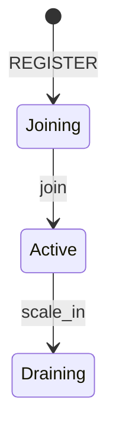
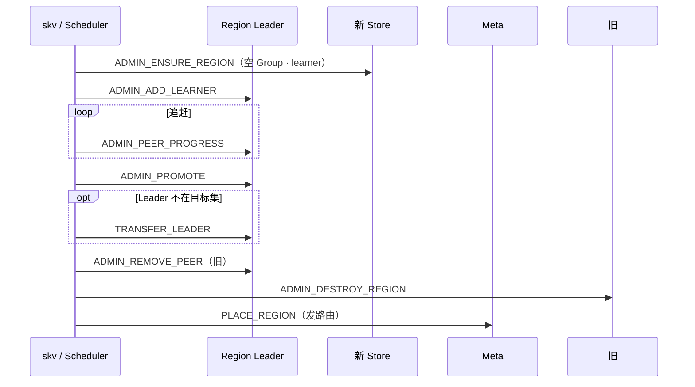

# 数据扩容设计

**状态：** 设计总览（与实现对齐）  
**读者：** 架构 / 运维 / 发版验收  
**相关：** [ARCHITECTURE.md](ARCHITECTURE.md) · [DATA_HA.md](DATA_HA.md) · [DATA_SCALE_IN.md](DATA_SCALE_IN.md)（缩容） · [扩容缩容设计.md](../flows/扩容缩容设计.md) · [REGION_OPS.md](../ops/REGION_OPS.md)

---

## 1. 问题与目标

「数据扩容」要回答三件事，路径不同，**不可混用**：

| 扩什么 | 默认手段 | 效果 |
|--------|----------|------|
| **Store 容量 / 打散负载** | 加节点 → `join` → **balance / place**（RF 恒定 Replace） | 副本迁到新机，旧机可腾盘 |
| **单 Region 过大** | `split`（切区间元数据） | 多组 Raft；**同机不搬 KV** |
| **副本冗余（非默认）** | Meta `SCALE_OUT` 加 Learner→Voter | **抬 RF**；仅补副本 / 演练 |

**目标（可验收）：**

1. 新 Store 拉起后仅为 **Joining**：不进调度、不持副本。
2. 运维 `join` → **Active** 后，`balance` / `place` 可把 Region 迁入；迁完后路由可见，读写无感。
3. 全程 **默认 RF 不变**（通常仍为 3）；多数派始终 ≥ 2。
4. Helm `replicaCount.storage+1` **不等于**扩容完成——须人工 join + balance。

非目标：把 Split 当缩容；扩容路径自动抬 RF；加 Pod 自动 join。

---

## 2. 两阶段模型（加节点 ≠ 加入集群）


| 阶段 | 谁做 | Meta 状态 | 路由上的副本 |
|------|------|-----------|--------------|
| **A. 增加节点** | Helm / `skv start` / 配 conf | `Joining` | **无**（regions=0） |
| **B. 加入并扩容** | 运维页 / `skv join` + `balance` | `Active` → 持副本 | Place 完成后有 |

K8s 细则：[K8S_SCALE.md](../flows/K8S_SCALE.md)。本地 SOP：[SCALE_OUT_SOP.md](../ops/SCALE_OUT_SOP.md)。

**新 Store conf 约束（ordinal ≥ RF）：** `bootstrap_regions` 空、`raft_peers` **仅自己**——禁止写成全员 peers（会抢选主）。

---

## 3. Store 生命周期（扩容相关）

| 状态 | 扩容含义 |
|------|----------|
| `Joining` | 待加入；**不**进 `suggest_placement` / balance |
| `Active` | 可调度、可放副本 |
| `Draining` / `Tombstone` | 缩容路径（见 [扩容缩容设计.md](../flows/扩容缩容设计.md) §2） |
| `Offline` | HB 超时；补副本，不是扩容 |



`JOIN_NODE` 前置：Store **PING 可达**且心跳在 TTL 内。

---

## 4. 默认扩容路径：join → balance（Replace）

### 4.1 步骤

1. 确认新节点 `Joining`：`skv nodes storage`
2. `skv join storage-N` → `Active`
3. （可选）先有 ≥2 Region：`skv split …`，否则单 Region 也可 `place` / 多次 balance
4. `skv balance [n]`：`RegionScheduler` 找过载与轻载差 ≥ 2，入队 MigrateTask
5. 每个任务走 **Place 同构路径**（见 §5），完成后 `route_ver++`

```bash
./build/tools/skv join storage-3
./build/tools/skv balance
./build/tools/skv balance 3    # 最多入队 3 个
./build/tools/skv route
```

可选：`SKV_PD_AUTO_BALANCE=1` 让 Meta 周期性主动 balance（默认关）。

### 4.2 为何是 Replace

对每个待迁 Region：在**新 Store 上加副本并追齐 → Promote → 踢掉旧 peer**。  
成员数仍 = RF；不是「每个 Region 多挂一台」。

与 HA 关系：迁出窗口内短暂可能有 Learner；投票多数派仍按 voter 集。见 [DATA_HA.md](DATA_HA.md)。

---

## 5. 数据面算子 = Place

扩容真正「搬数据」只发生在跨机迁副本时：



| 步 | 命令 | 作用 |
|----|------|------|
| ENSURE | `ADMIN_ENSURE_REGION` | 目标机建空 Raft；`*N` learner |
| ADD | `ADMIN_ADD_LEARNER` | ConfChange；收 AE/Snapshot |
| 追赶 | `ADMIN_PEER_PROGRESS` | `match ≥ commit` → caught |
| PROMOTE | `ADMIN_PROMOTE` | learner → voter（Joint 未退出则 `busy`，重试） |
| 转主 | `TRANSFER` / `CAMPAIGN` | 避免先踢当前 Leader |
| REMOVE + DESTROY | 踢旧 + 清本地 | 防迟到 `RAFT_*` 脑裂 |
| 发布 | Meta `PLACE_REGION` | 路由与成员对齐 |

编排：`skv place` · `StorageNode::place_region` · Scheduler 钩子。详解：[REGION_OPS.md](../ops/REGION_OPS.md) · [10-region-placement.md](../flows/10-region-placement.md)。

---

## 6. 非默认：`SCALE_OUT`（抬 RF）

Meta `SCALE_OUT <node> [rids…]` → `Scaler`：AddLearner → catch-up → Promote → bump route。  
**会增加副本数**；仅补副本 / 演练。默认容量扩容**不要**走这条。

流程：[03-scale-out.md](../flows/03-scale-out.md)。并发排队 / 取消见 `it-replica-churn.sh`（I39）。

---

## 7. 与 Split / Merge 的边界

| 操作 | 改什么 | 是否腾盘 / 进新机 |
|------|--------|-------------------|
| **Split** | 切 `[start,end)`；右片继承左副本集；同机 share RocksDB | **否** |
| **balance / place** | 改某 Region 副本成员 | **是**（跨机才 Snapshot） |
| **Merge** | 相邻区间并回 | 否（减 Region 数） |
| **scale-in** | Store → Draining → 迁光 | 是（缩容，非扩容） |

**Split 不耦合 scatter。** 无感扩容 = `join` → `balance`；热点打散 = Split 后**单独** `place`。

---

## 8. 文档地图

| 层级 | 文档 | 内容 |
|------|------|------|
| **本页** | `architecture/DATA_SCALE.md` | 目标、两阶段、默认/非默认、Place、边界、验收 |
| 状态机 + 缩容 | [扩容缩容设计.md](../flows/扩容缩容设计.md) | Joining…Tombstone、scale-in、协议表 |
| Place 流程 | [10-region-placement.md](../flows/10-region-placement.md) · [REGION_OPS.md](../ops/REGION_OPS.md) | ConfChange 逐步 |
| 抬 RF | [03-scale-out.md](../flows/03-scale-out.md) | Scaler 状态机 |
| 本地 SOP | [SCALE_OUT_SOP.md](../ops/SCALE_OUT_SOP.md) · [SCALE_LIVE_SOP.md](../ops/SCALE_LIVE_SOP.md) | 命令抄写 |
| K8s | [K8S_SCALE.md](../flows/K8S_SCALE.md) | Helm A/B 阶段 |
| 用户入口 | [USER_GUIDE.md](../USER_GUIDE.md) §4 | 加节点 ≠ 加入 |

---

## 9. 验收标准

| ID | 命令 / 动作 | 期望 |
|----|-------------|------|
| SX-1 | Helm/进程加 Store | `state=Joining`；`route` 无该机副本 |
| SX-2 | `skv join` + `skv balance` / `place` | 目标 Store `Active` 且 `regions>0`；Put/Get 成功 |
| SX-3 | 扩容前后 `skv route` | 默认路径 RF **不变**（仍 3 voter，除非显式 `SCALE_OUT`） |
| SX-4 | `bash scripts/it-scale-live.sh` | join→balance→scale-in 持续流量下 PASS |
| SX-5 | `make it-region`（I30–I36） | scatter place 后双侧可读 |

登记：[TEST_CASES.md](../test/TEST_CASES.md) 扩缩容 / Region 行。
