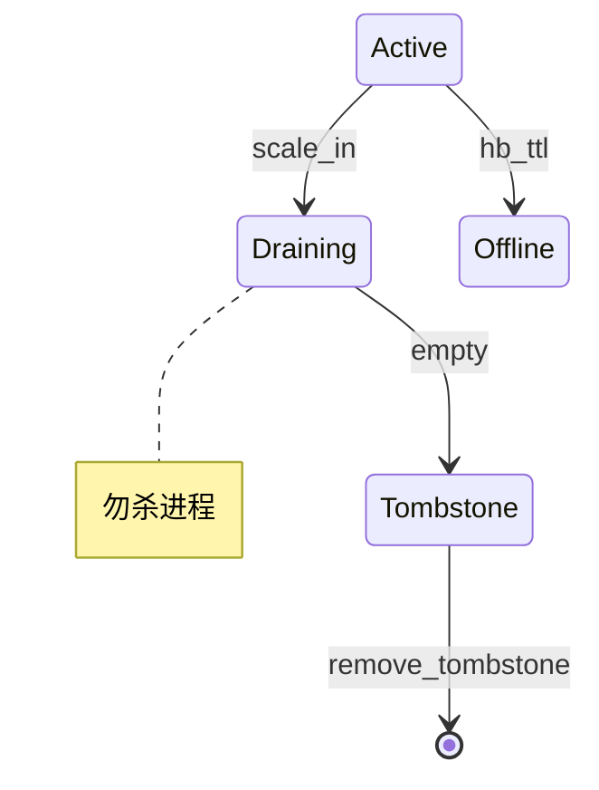

# 数据缩容设计

**状态：** 设计总览（与实现对齐）  
**读者：** 架构 / 运维 / 发版验收  
**相关：** [DATA_SCALE.md](DATA_SCALE.md)（扩容） · [DATA_HA.md](DATA_HA.md) · [扩容缩容设计.md](../flows/扩容缩容设计.md) · [SCALE_LIVE_SOP.md](../ops/SCALE_LIVE_SOP.md)

---

## 1. 问题与目标

「数据缩容」= **腾空一台 Storage**，再允许停进程 / 降副本 / 删盘。核心与扩容对称：**RF 恒定的 Replace peer**（把该机上的副本迁到其它 Active），**不是** Merge 减 Region、也不是直接杀进程。

| 缩什么 | 默认手段 | 效果 |
|--------|----------|------|
| **整机 Store** | `scale-in` → Draining → 迁光 → Tombstone → `remove-tombstone` | 路由不再含该节点；可停机删盘 |
| **某 Region 上的一个 peer** | `place` / 展开行「下线」→ REMOVE → DESTROY | 只动该 Region，不关整机 |
| **减 Region 数** | `merge`（相邻区间） | **不腾盘**；与 Store 缩容无关 |

**目标（可验收）：**

1. `scale-in` 后节点进入 **Draining**；Scheduler 把其上 Region 全部 Replace 走。
2. `region_count=0` 且 `leader_count=0` → **Tombstone**；`route` 不再出现该节点。
3. `remove-tombstone` 后 Meta 元数据擦除；再停进程 / Helm 降副本 / 删数据目录。
4. 全程 **默认 RF 不变**；迁出期间业务短超时重试即可近似无感。
5. Draining 期间 **禁止强杀**该 Store（迁出依赖进程存活）。

非目标：用 Merge 当缩容；丢多数派仍可写；Helm 先减 STS 再 drain。

---

## 2. 与扩容对称的路径


| 扩容 [DATA_SCALE](DATA_SCALE.md) | 缩容（本页） |
|----------------------------------|--------------|
| 加节点 → Joining → join → Active | Active → Draining → Tombstone → 踢出 |
| balance / place **迁入** | Scheduler **迁出**（同 Place 算子） |
| Helm +1 在 join **之前** | Helm -1 在 remove-tombstone **之后** |

对齐业界 `pd-ctl store delete`：先下线再迁光，最后才允许从拓扑抹掉。

---

## 3. Store 状态机（缩容段）

| 状态 | 缩容含义 |
|------|----------|
| `Active` | 可被选为缩容目标 |
| `Draining` | 已下线；**不进**新 placement；正在迁出全部 Region |
| `Tombstone` | 已空；可 `remove-tombstone` |
| `Offline` | HB 超时；走补副本，**不是**正常缩容 |
| `Joining` | 从未 Active：缩容 = 直接停进程（无副本可迁） |



**约束：**

- `Draining` / `Tombstone` **不会**因 REGISTER/心跳自动回到 Active。
- `suggest_placement` 仅 Active（排除 Draining / Tombstone / Offline / Joining）。
- 须有足够 **其它 Active** 承接 Replace（通常 ≥ RF，且目标机可 ENSURE）；IT 会优先选与 spare 重叠少的节点，避免补位撞上仍占 RocksDB LOCK 的刚踢节点。

---

## 4. 逐步：整机 scale-in

### 4.1 运维命令

```bash
./build/tools/skv nodes storage
./build/tools/skv scale-in storage-0
./build/tools/skv scale-in-status storage-0   # state / regions / leaders
# … 等到 Tombstone …
./build/tools/skv route                       # 不应再出现 storage-0
./build/tools/skv remove-tombstone storage-0
# 然后停进程 / Helm 降 replicaCount.storage / 删 data
```

Web：下线 / `POST /api/scale-in` · 状态 `GET /api/scale-in-status` · `POST /api/remove-tombstone`。

### 4.2 Meta + Scheduler

| 步 | 谁 | 动作 |
|----|-----|------|
| 1 | Meta | `STORE_DELETE` / `DRAIN_NODE` → 节点 `Draining` |
| 2 | `RegionScheduler` | 扫描仍挂在该 Store 上的 Region |
| 3 | 每 Region | `suggest_replace_away` → 数据面 **Place**（ENSURE 新机 → Learner → 追赶 → Promote → TRANSFER → REMOVE 本机 → DESTROY） |
| 4 | Meta | 各次 `PLACE_REGION`；`region_count→0` → `Tombstone` |
| 5 | 运维 | `REMOVE_TOMBSTONE` / `KICK_NODE` 擦元数据 |

Place 算子与扩容相同，见 [DATA_SCALE.md](DATA_SCALE.md) §5 · [REGION_OPS.md](../ops/REGION_OPS.md)。

### 4.3 两套「下线 / 踢出」

| 粒度 | 下线 | 踢出 |
|------|------|------|
| **Region peer** | TRANSFER（若 Leader）→ `ADMIN_REMOVE_PEER` → Meta PLACE；本地数据可仍在 | 须已不在成员表 → `ADMIN_DESTROY_REGION` |
| **整机 Store** | `STORE_DELETE` → Draining（迁光，勿杀） | 已 Tombstone → `remove-tombstone` |

禁止：未 REMOVE 就 DESTROY（易脑裂）；Draining 中途 `kill -9` / 先 Helm scale 掉 STS。

---

## 5. 前置与失败模式

| 条件 / 现象 | 处理 |
|-------------|------|
| Active Store 数不足承接 RF | 先 `join` 空闲节点作 spare，再 scale-in |
| `scale-in-status` regions 长期 >0 | 查 Place 日志：`not_leader` / `promote_failed` / `busy class=joint`；勿杀进程，重试调度 |
| 被缩容节点仍在 `route` | 未迁完或未发 `PLACE_REGION` |
| Joining 节点「缩容」 | 无副本：停进程即可，不必 `scale-in` |
| 误把 Offline 当缩容 | Offline 是故障；恢复 HB 或补副本，走 FAULT_DRILL |

---

## 6. 与 Split / Merge / 扩容边界

| 操作 | 是否腾空 Store |
|------|----------------|
| Split | 否（同机 share 引擎） |
| Merge | 否（只减 Region 数） |
| balance / place | 可腾单 Region peer |
| **scale-in** | **是**（整机迁光） |
| 扩容 join+balance | 对称的迁入 |

缩容靠迁副本，**不靠 Merge**。

---

## 7. K8s 顺序

1. 运维页 / `skv scale-in` → Tombstone  
2. `remove-tombstone`  
3. **再** `helm upgrade … replicaCount.storage-1`  

详见 [K8S_SCALE.md](../flows/K8S_SCALE.md) §4。先减 Pod 再 drain = 数据面半残。

---

## 8. 文档地图

| 层级 | 文档 | 内容 |
|------|------|------|
| **本页** | `architecture/DATA_SCALE_IN.md` | 目标、状态机、逐步、边界、验收 |
| 对称扩容 | [DATA_SCALE.md](DATA_SCALE.md) | join → balance |
| 状态机全文 | [扩容缩容设计.md](../flows/扩容缩容设计.md) | 上下线两套语义 |
| 无感 SOP | [SCALE_LIVE_SOP.md](../ops/SCALE_LIVE_SOP.md) · [SCALE_OUT_SOP.md](../ops/SCALE_OUT_SOP.md) SOP D | 持续流量下命令 |
| Place | [10-region-placement.md](../flows/10-region-placement.md) · [REGION_OPS.md](../ops/REGION_OPS.md) | ConfChange |
| CLI / Console | [SKV_CLI.md](../ops/SKV_CLI.md) · [ADMIN_CONSOLE.md](../ops/ADMIN_CONSOLE.md) | 入口 |

---

## 9. 验收标准

| ID | 命令 / 动作 | 期望 |
|----|-------------|------|
| SI-1 | `skv scale-in <node>` | 立即或很快 `state=Draining` |
| SI-2 | 轮询 `scale-in-status` | `regions→0`、`leaders→0` → Tombstone |
| SI-3 | `skv route` | 无该节点；Put/Get 仍成功（其余多数派） |
| SI-4 | `remove-tombstone` 后 | Meta 节点表无该 id；可安全停进程 |
| SI-5 | `bash scripts/it-scale-in-live.sh` 或 `it-scale-live.sh` | 持续流量下 PASS |

登记：[TEST_CASES.md](../test/TEST_CASES.md) 缩容 / 扩缩容行。
