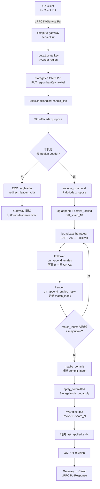

# 流程：写入 Put

**路径：** Client → gRPC Gateway → Range locate → Storage TCP → Region Raft Leader → 多数派提交 → apply → RocksDB

**关键代码：** `client/go/kv` · `compute-gateway` · `internal/route` · `storagetcp` · `ExecLineHandler` · `StoreFacade::propose` · `RaftNode::propose` · `StorageNode::on_apply` · `KvEngine::put`

**多数派：** RF=3 → 需 ≥2 副本 `match_index` 推进 `commit_index`

> 磁盘目录名仍可能带 `shard_<id>`（与 `region_id` 同号）；路由语义是 Range Region，见 [RANGE_SHARDING.md](../architecture/RANGE_SHARDING.md)。

## 落盘边界

| 层 | 目录 / 内容 |
|----|-------------|
| Raft WAL | `{data_dir}/raft_shard_<id>/hard.state` + `log.entries` |
| KV | `{data_dir}/shard_<id>/` RocksDB |

## 时序要点

1. `propose` 后同步轮询 `soft_state.last_applied`（demo 模型，非异步回调）。
2. 空心跳 / 写触发的 AE 都会推进复制。
3. 仅 **当前 term** 的日志条目可被 `maybe_commit` 提交。
