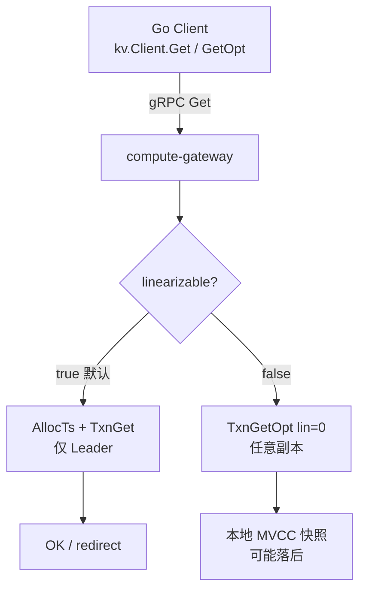

# 流程：读取 Get

**路径：** Client → gRPC Gateway → Range locate → Storage TCP

**关键代码：** `internal/route` · `StoreFacade::txn_get` / `get` · `ExecLineHandler` · Gateway `Get` / `getStale`

## 两种读语义

| 模式 | `linearizable` | 行为 |
|------|----------------|------|
| 线性一致（默认） | `true` | TSO + Leader `TXN_GET`；Percolator 可见性 |
| 读副本 / 脏读 | `false` | 任意副本 `TXN_GET … 0`；无 ReadIndex，可能落后 |

SDK：`Get` 强一致；`GetOpt(ctx, key, false)` 副本读。

## 注意

- 无 Raft ReadIndex：副本读不提供线性一致边界。
- BatchGet 固定强一致；逐 key 副本读请用 `GetOpt`。
