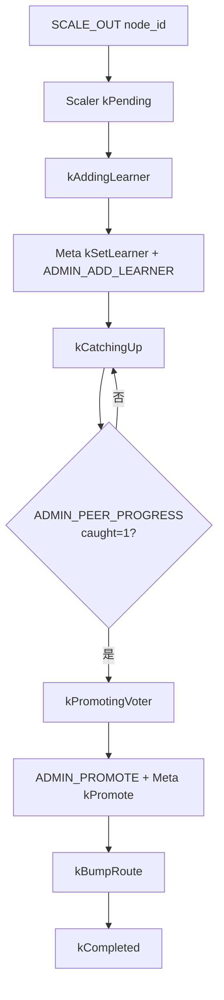

# 流程：在线扩容 Scale-out（高级：加副本）

> **默认扩容**请看 [DATA_SCALE.md](../architecture/DATA_SCALE.md) / [扩容缩容设计.md](扩容缩容设计.md)：新 Store Active 后 **Balance Replace**（RF 不变）。  
> 本文描述的 `SCALE_OUT` 会给 Region **增加**副本，仅作补副本 / 演练。

**路径：** `SCALE_OUT` → Meta Leader `Scaler` → Meta Raft 路由 + Storage ConfChange + catch-up → Promote

**关键代码：** `meta/src/scaler.cpp` · `MetaNode::{storage_rpc,region_leader_addr}` · Storage `ADMIN_ADD_LEARNER` / `ADMIN_PEER_PROGRESS` / `ADMIN_PROMOTE`

## TCP

| 命令 | 说明 |
|------|------|
| `SCALE_OUT <node_id> [rid,rid…]` | 启动扩容；regions 空=全部 |
| `GET_SCALE <task_id>` | 查进度 |
| `LIST_SCALE` | 列出任务 |

新节点须先 `REGISTER` → `join`（Joining→Active），且非 Offline/Draining/Tombstone。

## 相关

| 面 | 操作 |
|----|------|
| Meta | `kSetLearner` / `kPromote` / `kBumpRoute` |
| Storage | ConfChange Learner → 追赶 → Voter |
