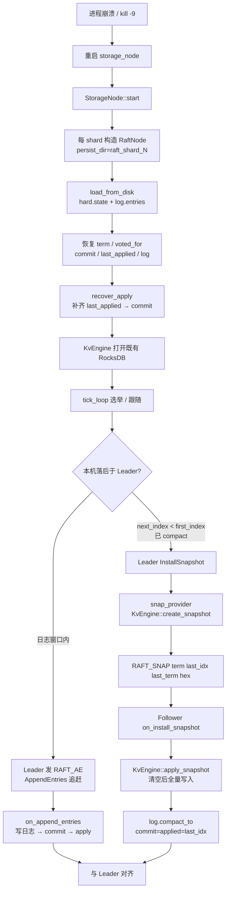
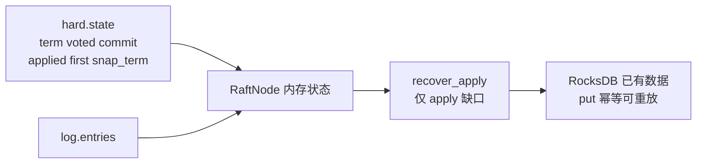

# 流程：故障恢复

**设计总览：** [DATA_HA.md](../architecture/DATA_HA.md) §3.2 · 演练：[FAULT_DRILL.md](../ops/FAULT_DRILL.md)。

**场景：** Storage 宕机再启；或落后过久超出本地日志窗口。

**关键代码：** `RaftPersist` · `RaftNode::load_from_disk` / `recover_apply` · `RAFT_AE` · `RAFT_SNAP` · `KvEngine::{create,apply}_snapshot`

## 启动装载细节

## 何时走 Snapshot

| 条件 | 动作 |
|------|------|
| Leader `log.size() > compact_threshold(128)` 且已 apply | `maybe_compact` 丢弃前缀日志 |
| Follower `next_index < log.first_index()` | 无法 AE 对齐 → `InstallSnapshot` |
| AE 失败 | Leader 递减 `next_index`，可能最终落入快照窗口 |

## 验证

- 单测：`RaftPersistTest.SaveAndRecoverApplied` / `InstallSnapshotCompactsAndApplies`
- 冒烟：杀 `storage-1` 再启，日志出现 `recovered term=`
