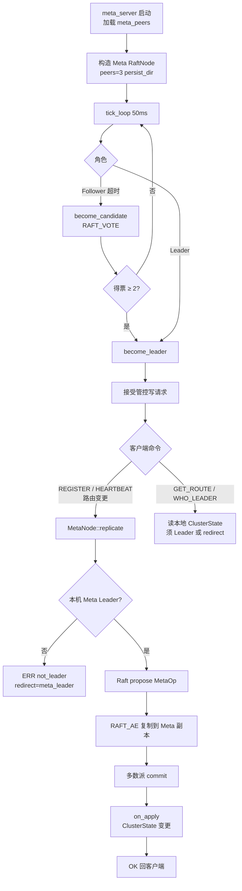
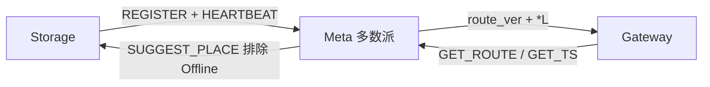

# 流程：Meta HA

**设计总览：** [DATA_HA.md](../architecture/DATA_HA.md) §4。

**拓扑：** 3 × `meta_server`（如 `:8500–8502`），单 Raft Group（`kMetaShard=0`），多数派 = 2。

**关键代码：** `MetaNode` · `MetaFsm` / `apply_meta_command` · `ClusterState` · 与 Storage 共用 `RaftNode` + `GrpcRaftTransport` 模式

## 管控命令映射

对外经 **gRPC / ExecLine**（历史行协议名仍如下）；Meta 内部共识走 `GrpcRaftTransport`。

| 命令 | MetaOp / 行为 |
|------|----------------|
| `REGISTER role id addr` | `kRegister` → `ClusterState::register_node` |
| `HEARTBEAT id n rid…` | `kHeartbeat` → 刷新存活 + 本机 Leader Region（`*L`） |
| （Leader tick） | `kSweepStale` → 超时 Storage → `Offline` |
| `GET_ROUTE` | 编码 `route_ver` + 各分片副本（`*L` / `*N`） |
| `WHO_LEADER` | 返回当前 Meta Leader |
| `RAFT_VOTE` / `RAFT_AE` | Meta 内部共识（shard 字段可忽略） |

## 与数据面关系

**生产要点（M1）：**

- Meta Raft：`data_dir/raft` 持久化 + `ClusterState` 快照重加入（见 FAULT_DRILL）。
- Storage：`register_and_heartbeat` 周期上报（`SKV_STORE_HB_SEC`，默认 2s）。
- 失联：`SKV_META_STORE_TTL_MS`（默认 10s）后 `Offline`，不再进入 `suggest_placement`。
