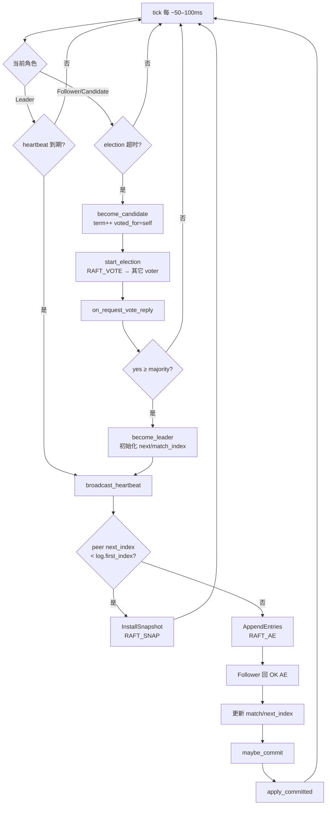
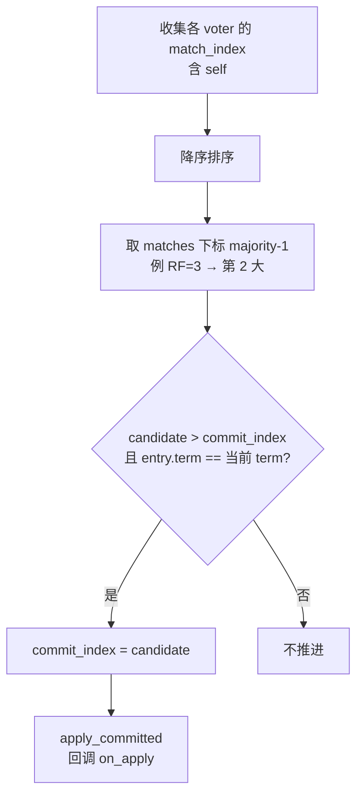
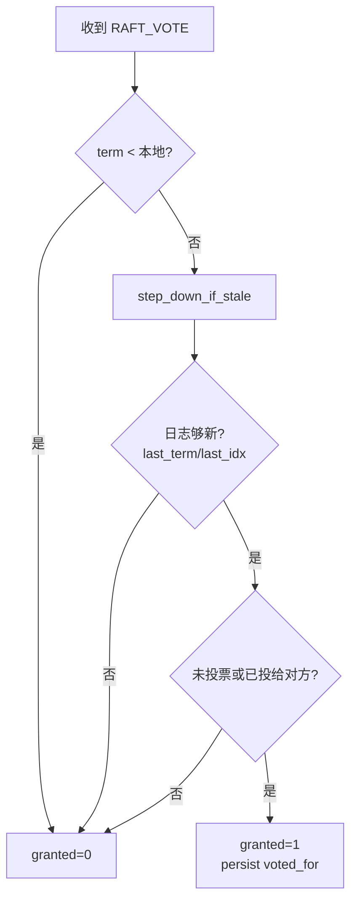

# 流程：Raft 选举 / 心跳 / 提交

**适用范围：** Storage 每分片一组 Raft；Meta 一组 Raft。算法同一套 `RaftNode`。

**关键代码：** `raft/src/raft_node.cpp` · `GrpcRaftTransport` · `MultiRaft::tick_all`

## 提交规则（maybe_commit）

## 选票授予（on_request_vote）

## RPC 线协议

| 类型 | 请求 | 响应 |
|------|------|------|
| RequestVote | `RAFT_VOTE shard from term last_idx last_term` | `OK VOTE term granted` |
| AppendEntries | `RAFT_AE shard from term prev prev_term commit n …` | `OK AE term success match` |
| InstallSnapshot | `RAFT_SNAP shard from term last_idx last_term hex` | `OK SNAP term success match` |
