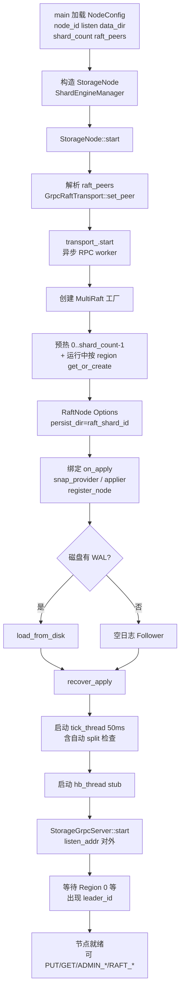
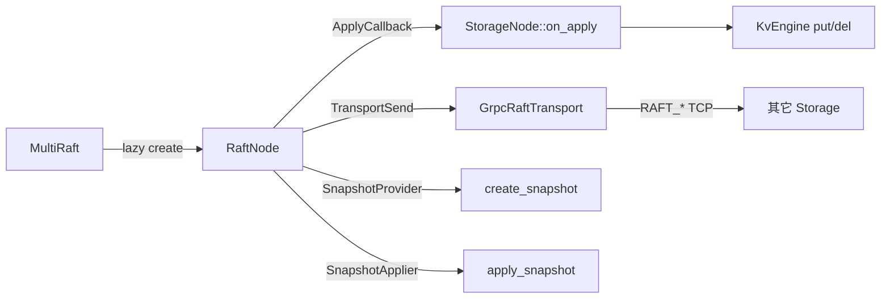

# 流程：Storage 节点启动

**入口：** `storage/src/main.cpp` → `StorageNode::start` → `StorageGrpcServer::start`

**关键代码：** `storage_node.cpp` · `exec_line_handler.cpp` · `ShardEngineManager` · `MultiRaft` factory

## 工厂内依赖关系

## 启动顺序约束

1. **先** `transport_.start` + 注册 Raft，**再**对外 gRPC（否则对等节点连不上 RaftService）。
2. RocksDB 在首次 `get_or_create(shard)` / apply 时打开，不必全部预热。
3. `recover_apply` 必须在对外服务前执行，避免已提交未应用的缺口。
