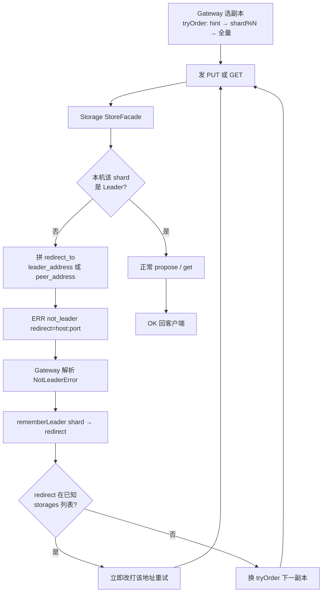
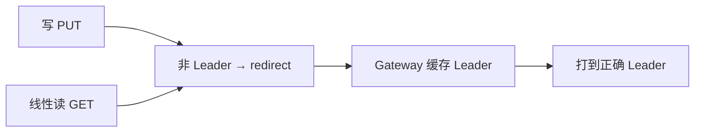

# 流程：not_leader 重定向

**目的：** 写/线性读打到 Follower 时，引导客户端（Gateway）改打当前 Leader，避免错写或脏读。

**错误码总目录：** [ERROR_CODES.md](../architecture/ERROR_CODES.md)。

**关键代码：** `StoreFacade::{propose,get}` · `storagetcp.NotLeaderError` · Gateway `rememberLeader` / `tryOrder` ·（可选）C++ `KvProxy`

## 各层错误形态

| 层 | 形态 |
|----|------|
| Storage TCP | `ERR not_leader redirect=127.0.0.1:9100` |
| Meta TCP | `ERR not_leader redirect=<meta_leader>` |
| Go `storagetcp` | `NotLeaderError{Redirect}` |
| Gateway | 更新 `leaderHint[shard]` 后重试 |

## 与读路径交叉

Follower 本地 RocksDB **不会**在线性读路径被返回给 Gateway（`linearizable=true`）。
