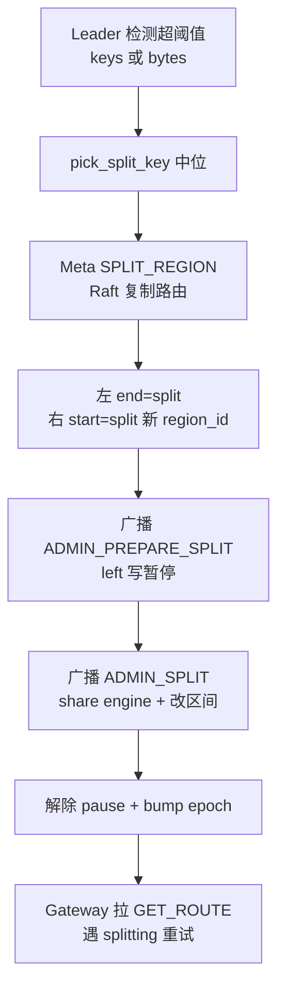
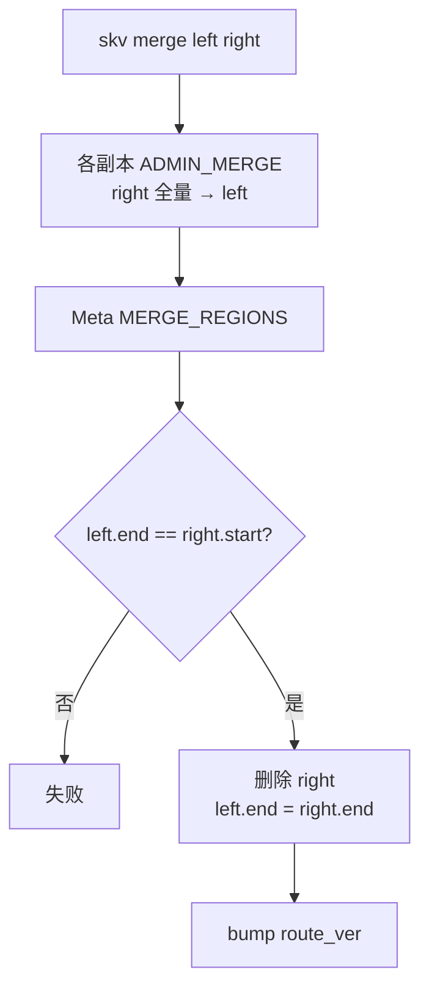

# 流程：Range 分裂 / 合并

**背景：** 有序 key 空间上的 Region（半开区间），每 Region 一组 Raft。见 [RANGE_SHARDING.md](../architecture/RANGE_SHARDING.md)。

**逐步操作与后端细节：** [REGION_OPS.md](../ops/REGION_OPS.md)（Split / Merge / Place / Scatter 全流程）。

## 分裂 Split

**流量窗口：** `PREPARE`→`SPLIT` 仅覆盖元数据 Raft apply（同机**不搬 KV**，）；Gateway 遇 `splitting` / `epoch_not_match` 刷路由重试。跨机打散见 Place/Scatter。

手动：`skv split <rid> <key>`（内部先 PREPARE 再 SPLIT）。详解 [REGION_OPS.md](../ops/REGION_OPS.md)。

## 合并 Merge

要求：**相邻**区间（`left.end_key == right.start_key`）。
