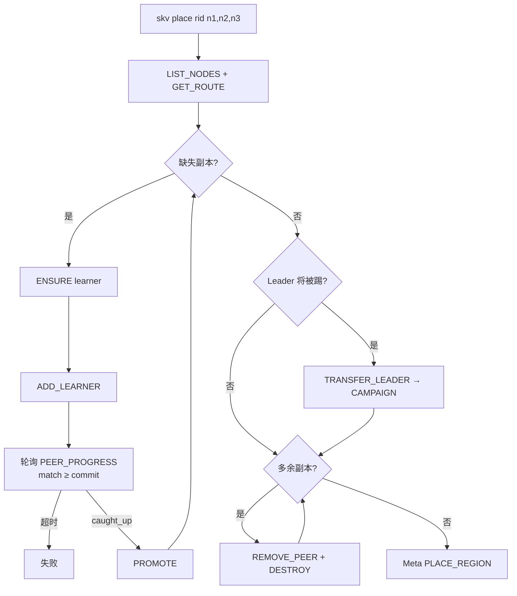

# 流程：Region 放置（place）

**目标：** Store 数 > RF 时，把 Region 副本迁到指定节点子集。

**逐步操作与后端细节：** [REGION_OPS.md](../ops/REGION_OPS.md)。Split 不自动 place；无感扩容走 join + balance。

**入口：** `skv place <region_id> <node1,node2,...>`



## 与 Split 的关系

Split 只切区间；需要跨机打散时**单独** place（或等 balance）：

```bash
skv split 0 m
skv place 1 storage-3,storage-4,storage-5
# 或 Storage 编排：
ADMIN_PLACE_REGION 1 storage-3,storage-4,storage-5
```

## 协议

| 面 | 命令 |
|----|------|
| Meta | `LIST_NODES` · `SUGGEST_PLACE` · `PLACE_REGION` · `FIND_MERGE_RIGHT` |
| Storage | `ADMIN_ENSURE_REGION` · `ADD_LEARNER` · `PEER_PROGRESS` · `PROMOTE` · `TRANSFER_LEADER` · `CAMPAIGN` · `REMOVE_PEER` · `DESTROY_REGION` · `ADMIN_PLACE_REGION` |

## 操作说明（会不会把服务弄挂）

`place` 最终会对**被踢出的副本**发 `ADMIN_DESTROY_REGION`。这是预期步骤，不是误操作。

历史上 DESTROY 会让 Storage 进程 abort，根因是：

1. **UAF**：`MultiRaft::tick_all` / 出站 RPC 持有裸 `RaftNode*`，DESTROY `erase` 后仍 `mutex.lock` → `mutex lock failed: Invalid argument`
2. **迟到 AE 复活**：DESTROY 后入站 `RAFT_*` 仍 `get_or_create`，与析构竞态，偶发空路径 `create_directories` / `rename`

已修复：

1. Group / 出站 RPC 用 `shared_ptr`；DESTROY 先 `unregister` + tombstone，拒绝迟到 RAFT，直到 `ENSURE` 再托管
2. `on_apply` 内禁止对**同一** RaftNode 再 `recover_apply`（AdminSplit 曾因此与 apply worker 自死锁，表现为重启卡住无端口）

手动建议：

```bash
# 查看当前路由与节点
./build/tools/skv route
./build/tools/skv nodes storage

# 把 region 0 迁到 storage-3,4,5（副本数 = RF）
./build/tools/skv place 0 storage-3,storage-4,storage-5

# 分裂后若需打散右片，再 place（不要耦合在 split 上）
./build/tools/skv split 0 m
./build/tools/skv place 1 storage-3,storage-4,storage-5
```

若 place 中途失败（`not_leader` / `promote_failed` / `busy class=joint`），先 `skv status` / `skv logs storage-N`，确认无 abort 后再重试同命令（幂等：已在目标集的跳过 ENSURE）。

## 日志里一堆 ERR 怎么看

全表：[ERROR_CODES.md](../architecture/ERROR_CODES.md)。常见：

| 现象 | 含义 |
|------|------|
| `ERR not_leader redirect=...` | Follower 拒写并指路 Leader；CLI 会跟 redirect。**旧版**对 6 台全广播时刷屏属噪音，现已只打 Region 副本。 |
| `FAIL recv failed / truncated` | TCP 读超时/截断（Admin propose 过慢）；已把超时放到 ~8s。 |
| `ERR busy class=joint` / `remove_failed` | Raft Joint ConfChange 未结束，不能连续 REMOVE/PROMOTE；CLI 会短等重试。 |
| `ERR no_region` | 节点上无该 Region（已 DESTROY，或从未 ENSURE）。Place 须走「当前成员 + 目标节点」地址，不能只信未更新的 Meta 路由。 |

真正失败看最后是否打出 `OK PLACE`，以及 `skv route` 副本是否已是目标集。
