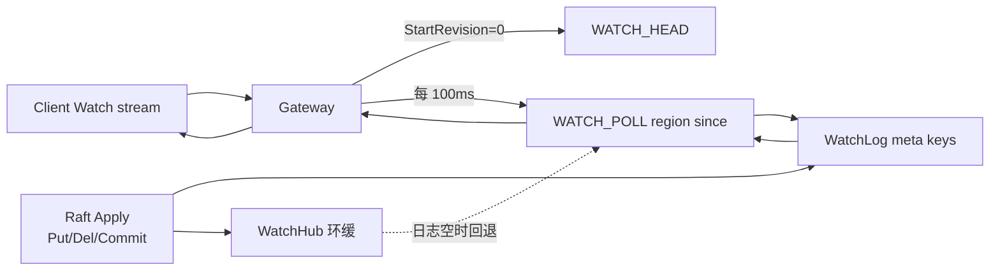

# 流程：Watch

**路径：** Client `Watch` 流 → Gateway 轮询 Storage `WATCH_POLL` → 持久化 Watch 日志（O3）

| 项 | 说明 |
|----|------|
| 精确 key | 订阅时先推当前快照（TxnGet），再推增量 |
| 前缀 | 过滤 `key_prefix`；轮询路由表内相关 Region |
| revision | **一律 Raft apply index**（含 Commit；不再用 `commit_ts`） |
| 持久化 | `\xff\xffskv/watch/{be64 index}`；默认保留最近 4096 条 |
| `WATCH_HEAD` | 返回 `last_applied`，供 `StartRevision=0` 起点 |
| 限制 | 单 Gateway 轮询 Leader；非 etcd 级长连接推送 |

示例：`client/go/examples/watch`。
