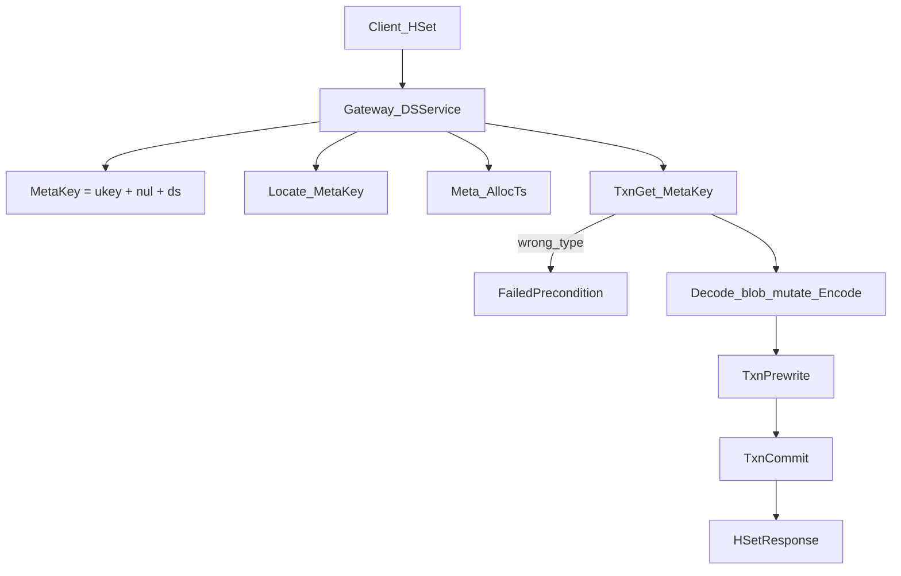
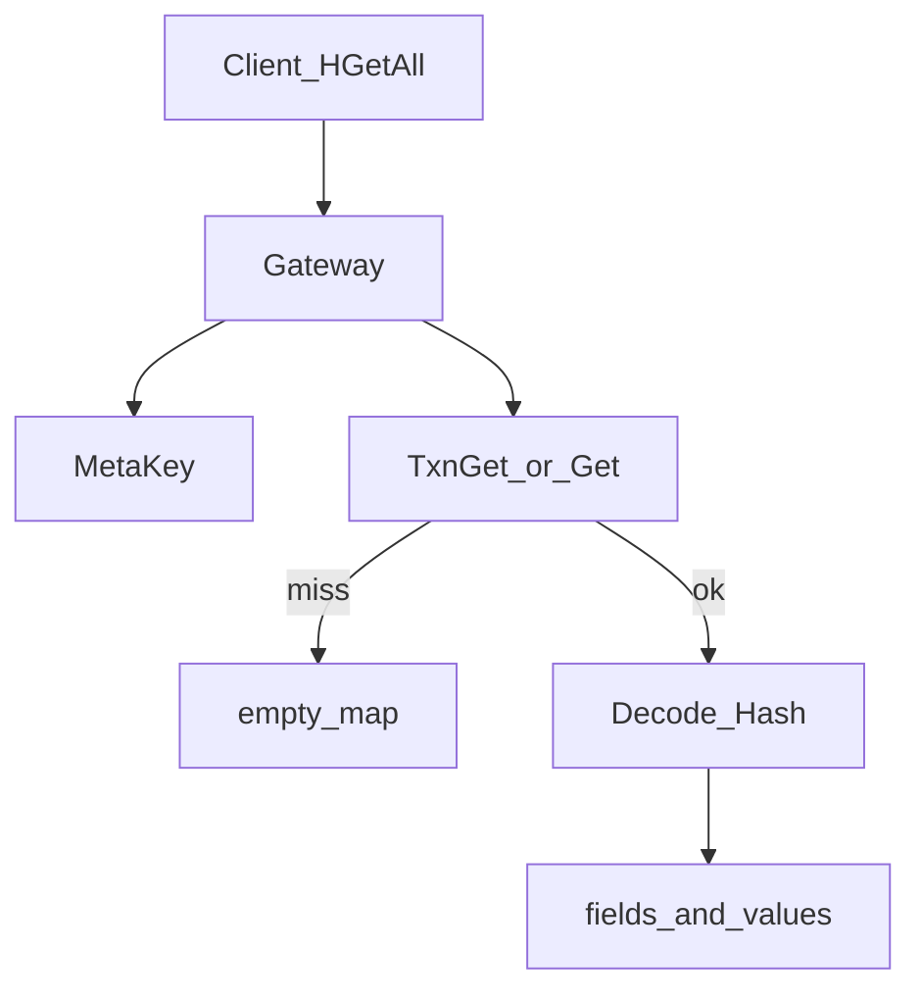

# 12 — 数据结构读写（DSService）

> 设计总览：[DATA_STRUCTURES.md](../architecture/DATA_STRUCTURES.md)

## 写路径（例：HSet）

## 读路径（例：HGetAll）

## 与普通 KV

- 普通 `Put(ukey)` **不会**覆盖 `MetaKey(ukey,'h')`
- DS 对象删除至空时删除 MetaKey（Del 短事务）
