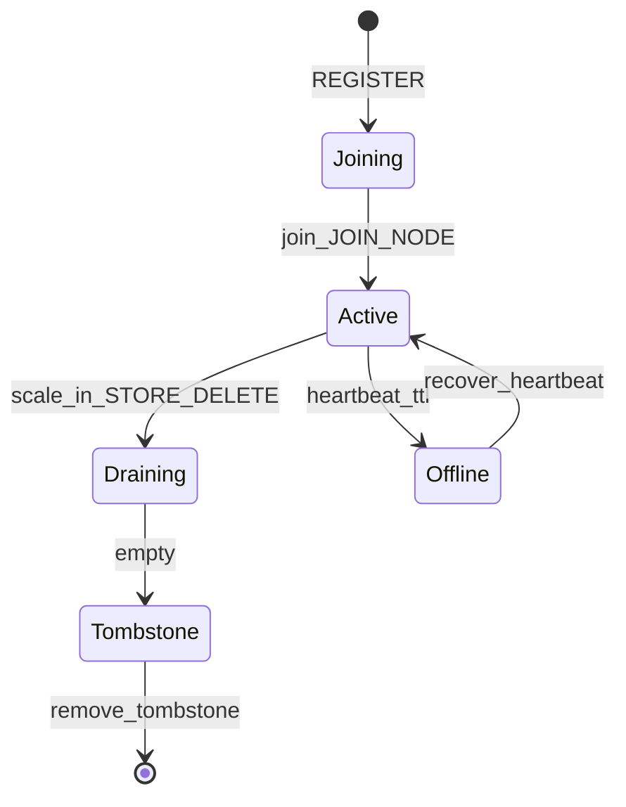

# 扩容 / 缩容设计

**数据扩容总览：** [DATA_SCALE.md](../architecture/DATA_SCALE.md) · **数据缩容总览：** [DATA_SCALE_IN.md](../architecture/DATA_SCALE_IN.md)

**目标：** Store 级扩容、缩容以 **RF 不变的 Replace peer** 为核心；Region Split/Merge 是区间运维，不是缩容手段。

相关实现：[REGION_OPS.md](../ops/REGION_OPS.md) · [SCALE_OUT_SOP.md](../ops/SCALE_OUT_SOP.md) · [SCALE_LIVE_SOP.md](../ops/SCALE_LIVE_SOP.md) · [10-region-placement.md](10-region-placement.md)

---

## 1. Store 状态机

| 本仓库 | 含义 |
|--------|------|
| `Joining` | 刚 REGISTER 的**待加入**节点；心跳不升 Active，须运维 `join` |
| `Active` | 已加入、可调度、可放副本 |
| `Draining` | `scale-in` / `STORE_DELETE`；迁出全部 Region |
| `Offline` | 心跳超时；补副本，非正常缩容 |
| `Tombstone` | `region_count=0` 且 `leader_count=0`；可 prune |



**约束：**

- `Joining` 为待使用节点：不参与 `suggest_placement` / balance；`JOIN_NODE` / `ACTIVATE_NODE` → Active
- `Draining` / `Tombstone` 不因 REGISTER/心跳自动回到 Active（须清 tomb 后重建，或 Offline 恢复）
- `suggest_placement` 仅 Active（排除 Joining / Offline / Draining / Tombstone）

---

## 2. 两套「上线 / 下线 / 踢出」

### Region 副本（展开 Region 行）

只动**该 Region** 的 peer，不关整机：

| 操作 | 含义 |
|------|------|
| **下线** | `TRANSFER`（若是 Leader）→ `ADMIN_REMOVE_PEER` → Meta `PLACE` 剩余成员；本地数据仍在 |
| **踢出** | 须已不在成员表 → `ADMIN_DESTROY_REGION` 清该 Store 上本 Region 数据 |
| **上线** | = 增加副本（`SCALE_OUT` / Learner→Promote） |

### Store 整机（待加入表 / 拓扑）

| 操作 | 含义 |
|------|------|
| **上线** | 拉起进程；Joining/Offline → `JOIN_NODE` → Active |
| **下线** | Active → `STORE_DELETE` → **Draining**（迁出副本，勿强杀）；Joining → 停进程 |
| **踢出** | 须**已下线**且路由无副本 → `KICK_NODE` 擦除元数据 |

对齐 `pd-ctl store delete`（缩容逐步见 [DATA_SCALE_IN.md](../architecture/DATA_SCALE_IN.md)）：

1. 下线 → Meta `STORE_DELETE` → `Draining`
2. `RegionScheduler` 扫描仍挂在该 Store 上的 Region
3. 对每个 Region：`suggest_replace_away` → `ADMIN_PLACE_REGION`
4. `region_count=0` → `Tombstone`
5. 踢出 → `KICK_NODE` / `REMOVE_TOMBSTONE`

```bash
./build/tools/skv scale-in storage-0
./build/tools/skv scale-in-status storage-0   # state / regions / leaders
./build/tools/skv nodes storage
# 待 Tombstone：
./build/tools/skv remove-tombstone storage-0
```

Draining 期间 **不要杀进程**（迁出期间保持进程）。

---

## 3. 扩容（scale-out，默认路径）

对齐「新 Store 准入 → balance」：

1. 默认集群：`storage-0/1/2` Active；`storage-3/4/5` 已在 `storage_peers` 但为 **`Joining`（待加入）**。另起新 Store 则 `REGISTER` → Joining
2. 运维确认后：`skv join storage-N` / Web「加入」→ `JOIN_NODE` → **`Active`**
3. `RegionScheduler` 周期性 `suggest_balance_move`：过载与轻载（含新 Active）差 ≥ 2 时 RF 恒定 Replace
4. 入队 MigrateTask → 同 Place 路径

```bash
./build/tools/skv nodes storage
./build/tools/skv join storage-3   # Joining → Active
./build/tools/skv balance          # 入队 1 个
./build/tools/skv balance 3        # 最多 3 个
```

**RF 始终不变**（Replace，不是给每个 Region 多挂一个副本）。

### 非默认：`SCALE_OUT`

Meta `SCALE_OUT <node> [rids…]` / 内部 `Scaler` 仍会给指定 Region **加 Learner 并 Promote**（抬副本数）。仅用于补副本演练；**会抬副本数，非默认 RF 不变扩容**。

---

## 4. Operator = Place

数据面在 Storage：

| 步骤 | 命令 |
|------|------|
| 创建空 peer | `ADMIN_ENSURE_REGION`（目标带 `*N` learner） |
| 加入 | `ADMIN_ADD_LEARNER` |
| 追赶 | `ADMIN_PEER_PROGRESS` |
| 转正 | `ADMIN_PROMOTE`（Joint 未退出则 `busy`，客户端重试） |
| 转主 | `ADMIN_TRANSFER_LEADER` + `ADMIN_CAMPAIGN` |
| 踢旧 | `ADMIN_REMOVE_PEER` → `ADMIN_DESTROY_REGION` |
| 发路由 | Meta `PLACE_REGION` |

编排入口：`skv place` · `StorageNode::place_region` · Meta 调度钩子 `ADMIN_PLACE_REGION`。

---

## 5. Meta 协议摘要

| 命令 | 作用 |
|------|------|
| `JOIN_NODE` / `ACTIVATE_NODE` | Joining（或 Offline）→ Active；须 Store **PING 可达**且心跳在 TTL 内 |
| `STORE_DELETE` / `DRAIN_NODE` | → Draining |
| `STORE_STATUS` | state + region/leader count |
| `REMOVE_TOMBSTONE` | 擦除 Tombstone 节点元数据 |
| `BALANCE [n]` | 入队 balance 迁移 |
| `SCHEDULE_MIGRATE` / `LIST_MIGRATE` | 手动/查看迁移任务 |
| `PLACE_REGION` | 仅更新路由（数据面已 Place 后） |
| `SCALE_OUT` | 高级：加副本（非默认扩容） |

---

## 6. 与 Split / Merge 的边界

| 操作 | 作用 | 是否腾盘 |
|------|------|----------|
| Split | 切元数据区间（副本集不变） | 否（同机共享引擎） |
| Place / balance | 跨机迁副本（RF 恒定 Replace） | 是 |
| Merge | 合并相邻小 Region | 否（减 Region 数） |
| scale-in | 腾空一台 Store | 是 |

**Split 不耦合 scatter。** 无感扩容路径是 `join` → Active → `balance`（Replace）；需要手动打散时单独 `skv place` / Web「放置」。缩容靠迁副本，不靠 Merge。
