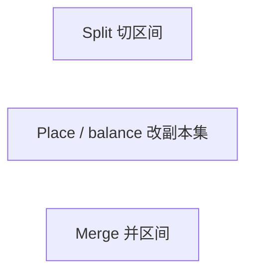
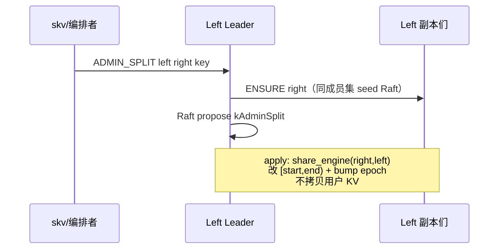
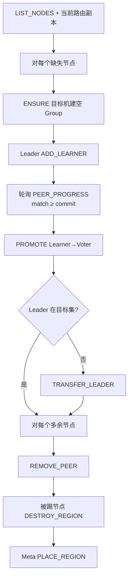

# Region 运维：Split / Merge / Place

逐步操作与后端行为说明。短流程图见 [flows/09-range-split-merge.md](../flows/09-range-split-merge.md)、[flows/10-region-placement.md](../flows/10-region-placement.md)；模型总览见 [RANGE_SHARDING.md](../architecture/RANGE_SHARDING.md)。

## 模型与关系

有序 **Range Region** `[start, end)`（`end` 空 = +∞），每 Region 一组 Raft（默认 RF=3）。路由权威在 **Meta**，数据与 ConfChange 在 **Storage MultiRaft**。



| 操作 | 改什么 | 不改什么 |
|------|--------|----------|
| **Split** | 切区间元数据；**同机不搬 KV**（同机共享引擎） | 右片默认仍在左片同一组 Store |
| **Place** | 某 Region 的副本成员集（跨机才搬数据） | 区间本身 |
| **Merge** | 相邻两片并回一片；共享引擎时只扩区间 | — |

**Split 不耦合 scatter。** 无感扩容：`join` → `balance`；热点打散：Split 后**单独** `place`。

运维入口：`./build/tools/skv`（CLI11）。东西向为 **gRPC**（Store/Raft/Admin/Meta 同端口）。

---

## 1. Split（分裂）

**入口**

- 手动：`skv split <region_id> <split_key>`
- 自动：Storage Leader tick，`SKV_SPLIT_KEYS` / `SKV_SPLIT_BYTES`（默认 `0` = 关）

**含义**：例如 `split 0 m` → 左 `[…, m)` 仍是 region `0`，右 `[m, …)` 新建 region（如 `1`）。

### 逐步（skv 手动）

| 步 | 谁 → 谁 | 命令 / 动作 | 后端效果 |
|----|---------|-------------|----------|
| 1 | skv → Meta Leader | `SPLIT_REGION <left> <hex(key)>` | Meta Raft 复制 `kSplitRegion`：切区间、分配 `right_id`、右片先继承左片副本表；`route_ver++` |
| 2 | Meta → skv | `OK SPLIT <left> <right>` | 拿到新 right id |
| 3 | skv → **所有** Storage | `ADMIN_PREPARE_SPLIT <left> <hex>` | left Leader propose；极短写暂停（仅盖住下一步元数据 apply） |
| 4 | skv → **所有** Storage | `ADMIN_SPLIT <left> <right> <hex>` | 见下「Storage 内部」——**无 `migrate_ge`** |
| 5 | Gateway / Client | 刷路由 | 遇 `splitting` / `epoch_not_match` → `GET_ROUTE` 重试 |

自动分裂：Storage 自调 Meta `SPLIT_REGION`，再广播 PREPARE / SPLIT（顺序与上相同）。

### Storage：`ADMIN_SPLIT` 内部（）



1. **`seed_right_region`**：各副本 ENSURE 右 Region 的 Raft Group（peers 与左相同）。
2. **Leader propose** `kAdminSplit`，apply 时：
   - `engines_.share_with(right, left)` —— **共用同一 RocksDB**
   - 左 `end=split`，右 `start=split`；bump epoch
   - **不**调用 `migrate_ge`
3. 读写作区间过滤（`key_in_region`）；跨机打散仍走 Place（learner + snapshot，快照按区间导出）。

**Split 不换机器、也不搬盘上数据。** 腾盘 / 打散用 Scatter / Place。

---

## 2. Place（放置 / 迁副本）

**入口**

- `skv place <rid> <node1,node2,...>`
- Storage：`ADMIN_PLACE_REGION` / `StorageNode::place_region()`（与 skv 同路径）

**目标**：该 Region 的 Raft 成员集变成指定节点列表（通常个数 = RF）。

### 逐步



| 步 | 命令 | 后端 |
|----|------|------|
| ENSURE | 打到**新节点** `ADMIN_ENSURE_REGION rid peers…` | `get_or_create` + 开引擎；`*N` = learner；清 DESTROY tombstone |
| ADD_LEARNER | Leader `ADMIN_ADD_LEARNER rid id@addr` | ConfChange 加 learner，开始收 AE/Snapshot |
| 追赶 | `ADMIN_PEER_PROGRESS rid peer` | Leader：`match ≥ commit` → `caught=1` |
| PROMOTE | `ADMIN_PROMOTE rid peer` | learner → voter |
| 转主 | `ADMIN_TRANSFER_LEADER`（可选 CAMPAIGN） | 避免先踢掉当前 Leader |
| REMOVE | `ADMIN_REMOVE_PEER rid peer` | ConfChange 删成员 |
| DESTROY | **被踢节点本地** `ADMIN_DESTROY_REGION rid` | unregister + tombstone + `MultiRaft::take`；拒迟到 `RAFT_*`，防脑裂 |
| 发布 | Meta `PLACE_REGION rid n1,n2,…` | 路由副本表与 Raft 配置对齐，`route_ver++` |

编排在 **skv** 与 **`StorageNode::place_region`** 两处同构。

DESTROY 历史问题与修复见 [flows/10-region-placement.md](../flows/10-region-placement.md)「操作说明」。

---

## 3. 打散（= 对某 Region Place）

历史上曾有 `split --scatter` / `SKV_SCATTER`：分裂后立刻 place 右片。已移除——**不符合无感扩容**（默认路径是 join + RF 恒定 balance）。

需要打散时：

```bash
./build/tools/skv split 0 m
./build/tools/skv place 1 storage-3,storage-4,storage-5
# 或 SUGGEST 后 place：
# Meta SUGGEST_PLACE avoid=storage-0,storage-1,storage-2
```

示例（RF=3，6 Store）：Split 后 Region0/1 都在 `s0–s2`；Place 后 Region1 可迁到 `s3–s5`。

---

## 4. Merge（合并）

**入口**：`skv merge <left> <right>`  
**前提**：相邻 — `left.end_key == right.start_key`。

### 逐步（先数据后路由）

| 步 | 谁 | 命令 | 后端 |
|----|-----|------|------|
| 1 | skv → 各 Storage | `ADMIN_MERGE left right` | Left Leader propose `kAdminMerge`；apply：right 全量并入 left，bump epoch |
| 2 | skv → Meta | `MERGE_REGIONS left right` | 校验相邻 → 删 right 路由 → `left.end = right.end` → `route_ver++` |
| 3 | 自动 merge 时 | 可选 `ADMIN_DESTROY_REGION right` | 本机卸掉 right Raft |

顺序固定为 **先搬数据再改 Meta**，避免路由已合并但 key 仍在 right。

自动：`SKV_MERGE_KEYS` → tick `FIND_MERGE_RIGHT` → 各副本 MERGE → Meta MERGE → DESTROY right。

---

## 5. 组件职责

| 层 | 职责 |
|----|------|
| **skv / ADMIN_PLACE** | 运维编排：gRPC ExecLine、轮询追赶、顺序控制 |
| **Meta** | 权威路由（区间 + 副本 + route_ver）；Split/Merge/Place/Suggest 元数据 Raft |
| **Storage MultiRaft** | 每 Region 一组 Raft；ConfChange、Learner 追赶、日志复制 |
| **KvEngine** | Split/Merge 的 `migrate_ge` / 全量迁移；epoch |
| **Gateway** | `LOCATE` / `GET_ROUTE`；splitting、epoch 不匹配时刷新重试 |

---

## 6. 命令速查

```bash
./build/tools/skv route
./build/tools/skv nodes storage
./build/tools/skv locate mykey

./build/tools/skv split 0 m              # 只切区间
./build/tools/skv place 1 storage-3,storage-4,storage-5
./build/tools/skv merge 0 1
```

| Meta | Storage |
|------|---------|
| `SPLIT_REGION` · `MERGE_REGIONS` · `PLACE_REGION` · `SUGGEST_PLACE` · `FIND_MERGE_RIGHT` · `GET_ROUTE` · `LOCATE` · `LIST_NODES` | `ADMIN_PREPARE_SPLIT` · `ADMIN_SPLIT` · `ADMIN_MERGE` · `ADMIN_ENSURE_REGION` · `ADMIN_ADD_LEARNER` · `ADMIN_PEER_PROGRESS` · `ADMIN_PROMOTE` · `ADMIN_TRANSFER_LEADER` · `ADMIN_CAMPAIGN` · `ADMIN_REMOVE_PEER` · `ADMIN_DESTROY_REGION` · `ADMIN_PLACE_REGION` |

环境变量（Storage 进程）：`SKV_SPLIT_KEYS` / `SKV_SPLIT_BYTES` / `SKV_MERGE_KEYS`。
