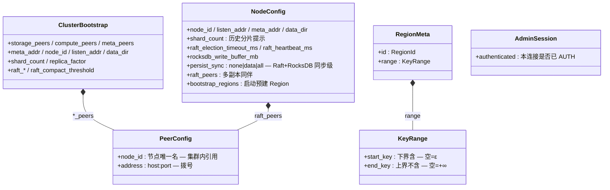
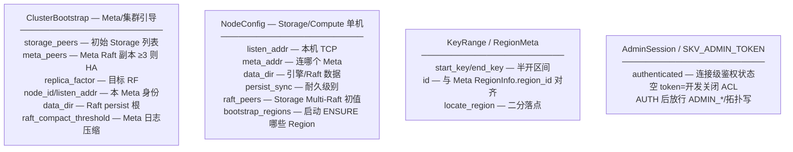
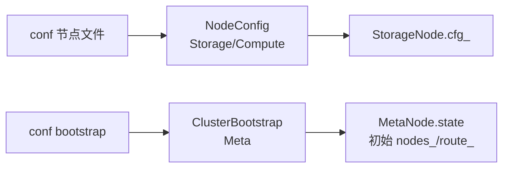

# Common 数据拓扑结构

跨进程共享的配置、Range、ACL、计数器等。  
图例：`字段 — 含义 / 作用`  
代码：`common/include/opskv/*.hpp`

---

## 1. 总图（字段 + 含义）

---

## 2. 配置与 Range 展开

---

## 3. 字段词典

### `PeerConfig`

| 字段 | 含义 | 作用 |
|------|------|------|
| `node_id` | 节点 ID | 配置与运行时引用 |
| `address` | 可达地址 | RPC / 路由 |

### `NodeConfig`

| 字段 | 含义 | 作用 |
|------|------|------|
| `node_id` | 本机 ID | Raft self / REGISTER |
| `listen_addr` | 监听 | TCP Server |
| `meta_addr` | Meta 地址 | 心跳/拉路由 |
| `data_dir` | 数据根 | RocksDB / Raft persist |
| `shard_count` | 历史字段 | 兼容；Range 模式下少用 |
| `raft_election_timeout_ms` | 选举超时 | Raft Options |
| `raft_heartbeat_ms` | 心跳间隔 | Raft Options |
| `rocksdb_write_buffer_mb` | memtable | 引擎调优 |
| `persist_sync` | 同步模式 | E1 耐久 |
| `raft_peers` | 同伴列表 | 建组初值 |
| `bootstrap_regions` | 预建 Region | 启动 ensure；空=等待 PLACE |

### `ClusterBootstrap`

| 字段 | 含义 | 作用 |
|------|------|------|
| `storage_peers` | 初始 Storage | Meta bootstrap_range |
| `compute_peers` | 计算节点列表 | 文档/运维 |
| `meta_peers` | Meta 副本 | Meta Raft 组网 |
| `meta_addr` / `listen_addr` | 地址 | 对外/监听 |
| `node_id` | 本 Meta ID | 多副本必填 |
| `data_dir` | Meta 数据根 | persist |
| `replica_factor` | RF | 放置副本数 |
| `raft_compact_threshold` | 压缩阈值 | Meta 日志 |

### `KeyRange` / `RegionMeta`

| 字段 | 含义 | 作用 |
|------|------|------|
| `start_key` | 区间起点（含） | `contains` / split |
| `end_key` | 区间终点（不含） | 空=+∞ |
| `RegionMeta.id` | Region 号 | Router 二分辅助 |
| `RegionMeta.range` | 区间 | 与 Meta 一致 |

### `AdminSession`

| 字段 | 含义 | 作用 |
|------|------|------|
| `authenticated` | 是否已 AUTH | 门闩运维命令 |

### `PeerCounter`（观测）

| 概念 | 含义 | 作用 |
|------|------|------|
| peer → count | 按对端累计 | STATS `peer_raft=` 等 |

---

## 4. 配置加载关系

---

## 相关

- [META_DATA_TOPOLOGY.md](META_DATA_TOPOLOGY.md)  
- [DATA_TOPOLOGY_INDEX.md](DATA_TOPOLOGY_INDEX.md)  
