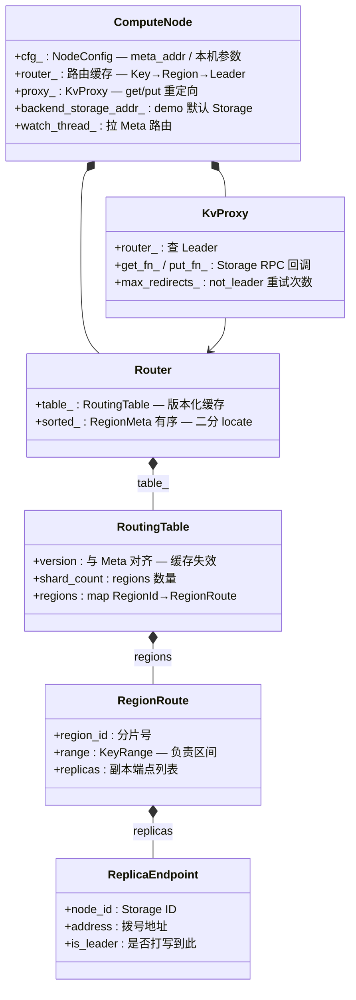
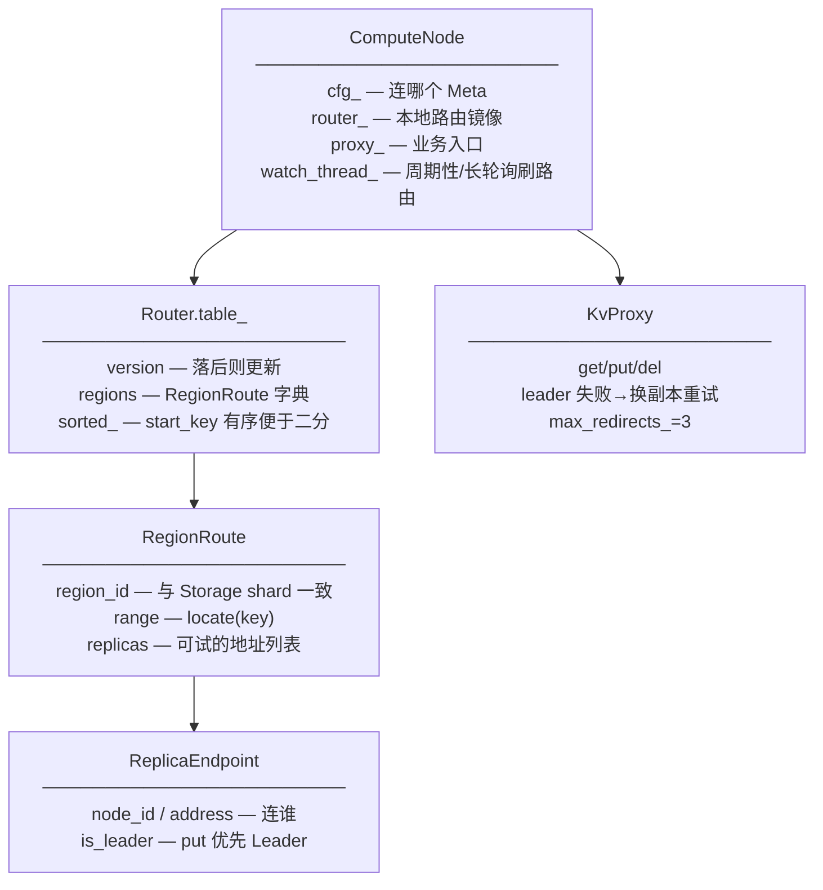
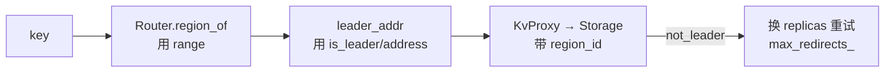

# Compute 数据拓扑结构

无状态计算层：缓存 Meta 路由 + 代理 Storage RPC。  
图例：`字段 — 含义 / 作用`  
代码：`compute/include/opskv/compute/*.hpp`  
（生产 Gateway 多为 Go；本模块为 C++ 对照实现。）

---

## 1. 总图（字段 + 含义）

---

## 2. 包含关系展开

---

## 3. 字段词典

### `ReplicaEndpoint` / `RegionRoute` / `RoutingTable`

| 字段 | 含义 | 作用 |
|------|------|------|
| `node_id` | Storage 节点 ID | 日志/调试 |
| `address` | `host:port` | RPC 目标 |
| `is_leader` | Leader 标记 | 写路径优先 |
| `region_id` | Region 号 | 请求带 shard |
| `range` | key 区间 | `region_of(key)` |
| `replicas` | 副本列表 | 重试候选 |
| `version` | 路由版本 | 与 Meta `route_ver` 对齐 |
| `shard_count` | Region 个数 | 兼容字段 |
| `regions` | 全表 | 缓存主体 |

### `Router`

| 字段 | 含义 | 作用 |
|------|------|------|
| `table_` | 路由表 | update 后对外查询 |
| `sorted_` | 有序 RegionMeta | 二分定位 key |
| `mu_` | 锁 | 并发 update/读 |

### `KvProxy` / 结果结构

| 字段 | 含义 | 作用 |
|------|------|------|
| `get_fn_` / `put_fn_` | 传输回调 | 注入 TCP/gRPC |
| `max_redirects_` | 最大重定向 | 防环 |
| `ProxyGetResult.ok/found/value/revision/error` | 读结果 | 上层业务 |
| `ProxyPutResult.ok/revision/error` | 写结果 | 上层业务 |

### `ComputeNode`

| 字段 | 含义 | 作用 |
|------|------|------|
| `cfg_` | 节点配置 | meta 地址等 |
| `router_` / `proxy_` | 核心组件 | 对外 API |
| `running_` / `watch_thread_` | 生命周期 | 后台刷路由 |
| `backend_storage_addr_` | 默认后端 | 单机 demo |

---

## 4. 请求路径与字段流

---

## 相关

- [META_DATA_TOPOLOGY.md](META_DATA_TOPOLOGY.md) — 权威路由在 Meta  
- [DATA_TOPOLOGY_INDEX.md](DATA_TOPOLOGY_INDEX.md)  
