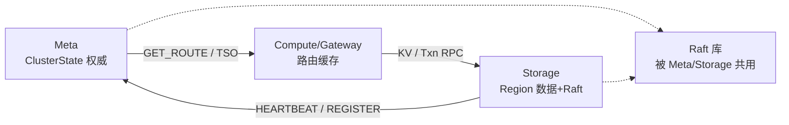

# 数据拓扑文档索引

归类见 [README.md](../README.md) §3。各模块统一格式：**Mermaid 结构图（字段 — 含义 / 作用）+ 字段词典表**。

| 模块 | 文档 | 核心对象 |
|------|------|----------|
| **Meta** | [META_DATA_TOPOLOGY.md](META_DATA_TOPOLOGY.md) | `ClusterState` / `RegionInfo` / TSO / 迁移 |
| **Raft** | [RAFT_DATA_TOPOLOGY.md](RAFT_DATA_TOPOLOGY.md) | `RaftNode` / `RaftLog` / `MultiRaft` / Persist |
| **Storage** | [STORE_DATA_TOPOLOGY.md](STORE_DATA_TOPOLOGY.md) | `StorageNode` / `KvEngine` / MVCC / `Command` |
| **Compute** | [COMPUTE_DATA_TOPOLOGY.md](COMPUTE_DATA_TOPOLOGY.md) | `Router` / `KvProxy` / 路由缓存 |
| **Common** | [COMMON_DATA_TOPOLOGY.md](COMMON_DATA_TOPOLOGY.md) | `NodeConfig` / `ClusterBootstrap` / `KeyRange` / ACL |

## 模块间数据流（概览）

生产要求文档（非拓扑）：[META_PRODUCTION.md](../production/META_PRODUCTION.md) · [STORE_PRODUCTION.md](../production/STORE_PRODUCTION.md) · [MULTI_RAFT_PRODUCTION.md](../production/MULTI_RAFT_PRODUCTION.md)
