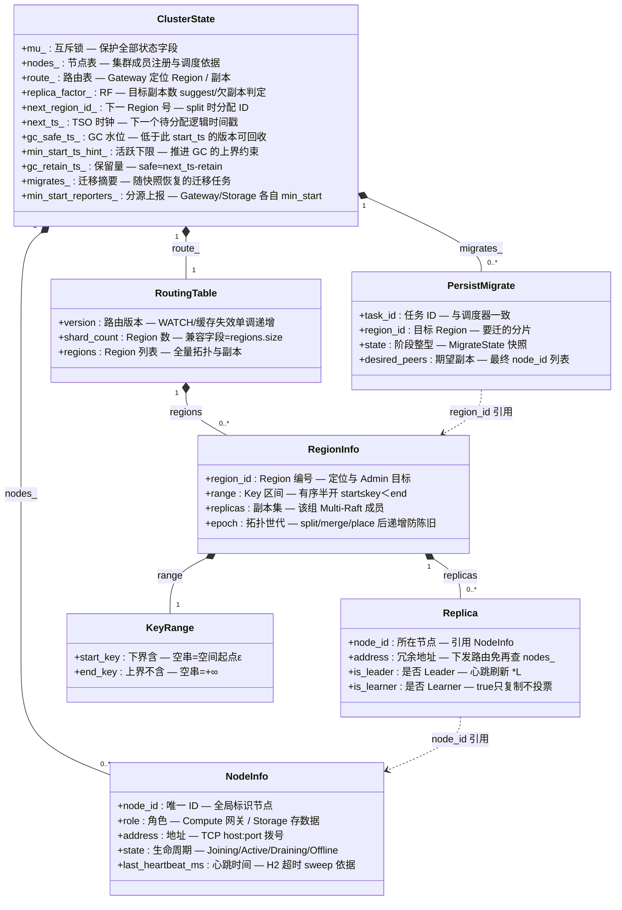
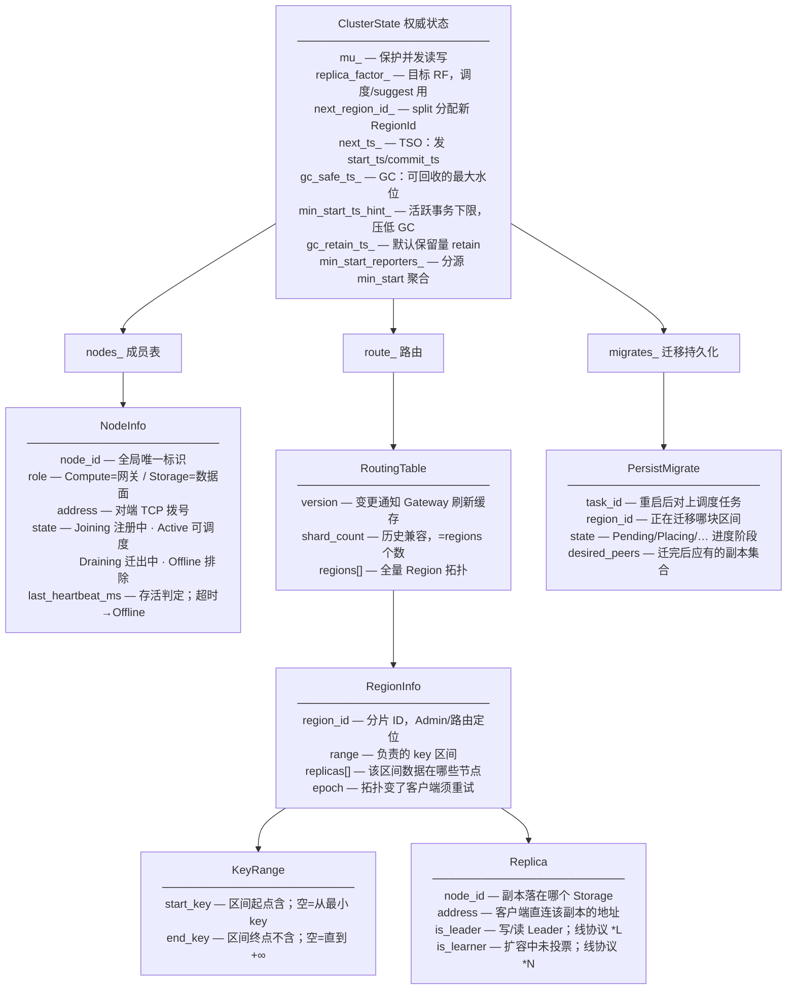
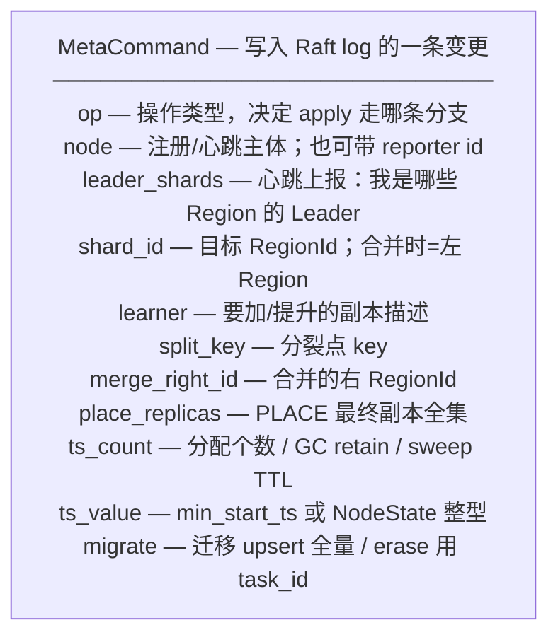
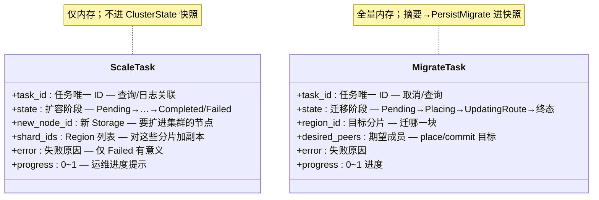
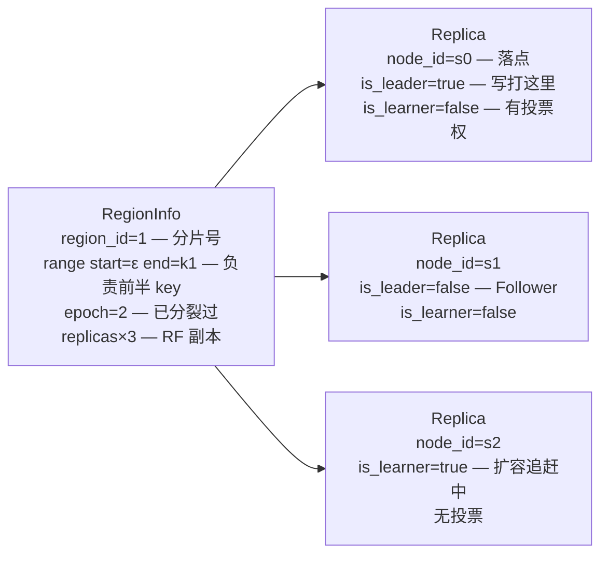
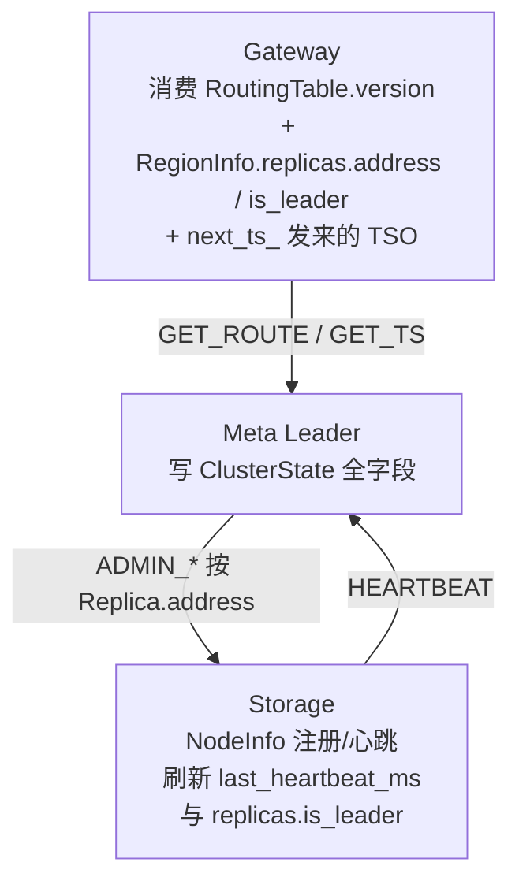

# Meta 数据拓扑结构

本文描述 **Meta 内存权威状态**（`ClusterState`）的数据层次，以及**各字段的含义与作用**。  
代码入口：`cluster_state.hpp` · `meta_fsm.hpp` · `scaler.hpp` · `region_scheduler.hpp`。

图例：`字段名 — 含义 / 作用`

---

## 1. 数据结构总图（字段 + 含义）

---

## 2. 包含关系展开（字段 · 含义 · 作用）

---

## 3. 字段词典（按结构）

### `ClusterState`

| 字段 | 含义 | 作用 |
|------|------|------|
| `mu_` | 互斥锁 | 多线程安全读写状态 |
| `nodes_` | 节点字典 | REGISTER/心跳/调度选点的权威来源 |
| `route_` | 路由表 | `GET_ROUTE` / `LOCATE` / Gateway 缓存内容 |
| `replica_factor_` | 目标 RF | `suggest_placement`、欠副本扫描 |
| `next_region_id_` | 下一 Region 号 | `split_region` 分配新 ID |
| `next_ts_` | TSO 逻辑时钟 | `alloc_ts` 发放事务时间戳 |
| `gc_safe_ts_` | GC SafePoint | Storage 可删掉更旧的 MVCC 版本 |
| `min_start_ts_hint_` | 全局最小活跃 start_ts | 推进 GC 时不能超过活跃事务 |
| `gc_retain_ts_` | 保留窗口 | `advance_gc_safe_ts` 默认 `next_ts - retain` |
| `migrates_` | 迁移任务摘要 | Meta 重启后 `restore_persisted` |
| `min_start_reporters_` | reporter→min_start | 多源上报取 min，避免单源漏报 |

### `NodeInfo`

| 字段 | 含义 | 作用 |
|------|------|------|
| `node_id` | 节点唯一名 | 心跳、副本、调度全部用它引用 |
| `role` | Compute / Storage | 过滤调度对象；Compute 不持 Region |
| `address` | `host:port` | Meta→Storage RPC、路由下发给客户端 |
| `state` | 生命周期 | Active 可放置；Draining/Offline 排除 |
| `last_heartbeat_ms` | 最近心跳 | H2 `sweep_stale` 判失联 |

### `RoutingTable` / `RegionInfo` / `KeyRange` / `Replica`

| 结构.字段 | 含义 | 作用 |
|-----------|------|------|
| `RoutingTable.version` | 路由世代号 | `WATCH_ROUTE`、Gateway 失效旧缓存 |
| `RoutingTable.shard_count` | Region 个数 | 兼容旧协议字段 |
| `RoutingTable.regions` | Region 数组 | 完整拓扑下发 |
| `RegionInfo.region_id` | 分片 ID | 定位、Admin、迁移目标 |
| `RegionInfo.range` | key 区间 | `locate(key)` 落点 |
| `RegionInfo.replicas` | 副本列表 | 客户端连哪台、谁是 Leader |
| `RegionInfo.epoch` | 拓扑世代 | 陈旧 epoch → 客户端刷新路由重试 |
| `KeyRange.start_key` | 区间下界（含） | 空 = 从空间起点 |
| `KeyRange.end_key` | 区间上界（不含） | 空 = +∞ |
| `Replica.node_id` | 副本所在节点 | 关联 `NodeInfo` |
| `Replica.address` | 副本地址 | 直连 Storage，少一次查表 |
| `Replica.is_leader` | Leader 标记 | 写路径打到 Leader；`*L` |
| `Replica.is_learner` | Learner 标记 | 扩容追赶中；不参与投票；`*N` |

### `PersistMigrate`

| 字段 | 含义 | 作用 |
|------|------|------|
| `task_id` | 任务 ID | 与内存 `MigrateTask` 对齐、去重 |
| `region_id` | 目标分片 | 知道迁哪一块 |
| `state` | 阶段快照 | 重启后从何处恢复 |
| `desired_peers` | 期望副本集 | place/commit 的目标成员 |

---

## 4. `MetaCommand`（Raft 载荷字段 · 含义 · 作用）

| 字段 | 含义 | 作用 |
|------|------|------|
| `op` | MetaOp 枚举 | 状态机分支选择 |
| `node` | 节点信息 | `kRegister` 写入 `nodes_`；心跳只用 id |
| `leader_shards` | Leader Region 列表 | 刷新 `Replica.is_leader`（H3） |
| `shard_id` | RegionId | Learner/Promote/Place/Split/Merge-left |
| `learner` | 副本描述 | 扩容加 Learner / Promote |
| `split_key` | 分裂点 | 左/右区间分界 |
| `merge_right_id` | 右 Region | 与 left 合并 |
| `place_replicas` | 最终副本集 | 原子替换 `RegionInfo.replicas` |
| `ts_count` | 计数/参数 | TSO 批大小；或 retain；或 ttl_ms |
| `ts_value` | 数值载荷 | 上报 min_start；或设置 NodeState |
| `migrate` | 迁移摘要 | 写入/删除 `migrates_` |

---

## 5. 运行时任务（字段 · 含义 · 作用）

| 结构 | 字段 | 含义 | 作用 |
|------|------|------|------|
| ScaleTask | `task_id` | 扩容任务 ID | `get_task` / 日志 |
| | `state` | 生命周期阶段 | worker 推进状态机 |
| | `new_node_id` | 新节点 | AddLearner/Promote 目标 |
| | `shard_ids` | 要扩的 Region | 空=全部 Region |
| | `error` | 失败信息 | 运维排障 |
| | `progress` | 进度 | UI/观测 |
| MigrateTask | `task_id` | 迁移任务 ID | cancel / 去重 |
| | `state` | 阶段 | place→更新路由 |
| | `region_id` | 目标 Region | 扫描入队键 |
| | `desired_peers` | 目标副本集 | 数据面+Meta PLACE |
| | `error` / `progress` | 同上 | 同上 |

---

## 6. Key 空间示例（字段语义）

---

## 7. 物理拓扑与字段流向

---

## 8. 相关文档

- [DATA_TOPOLOGY_INDEX.md](DATA_TOPOLOGY_INDEX.md) — 各模块拓扑索引  
- [META_PRODUCTION.md](../production/META_PRODUCTION.md)  
- [flows/05-meta-ha.md](../flows/05-meta-ha.md)  
- 同格式：[RAFT](RAFT_DATA_TOPOLOGY.md) · [STORE](STORE_DATA_TOPOLOGY.md) · [COMPUTE](COMPUTE_DATA_TOPOLOGY.md) · [COMMON](COMMON_DATA_TOPOLOGY.md)  

