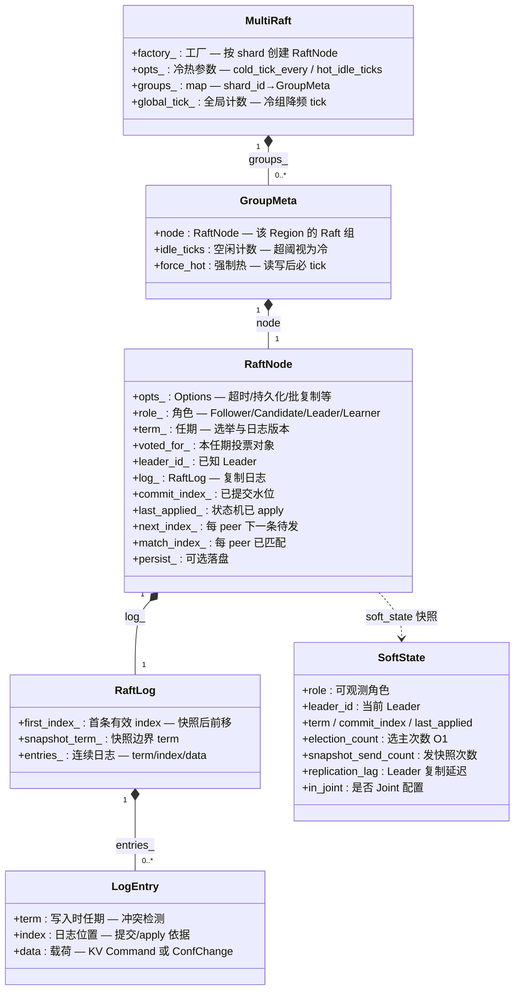
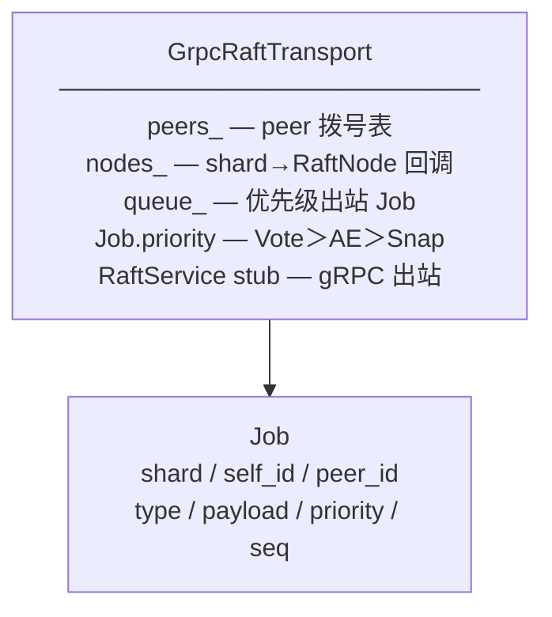
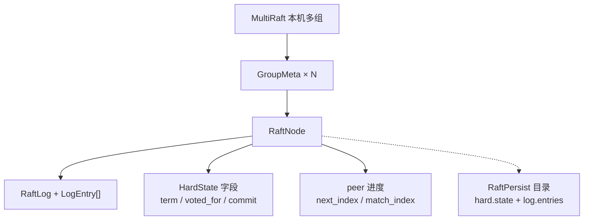

# Raft 数据拓扑结构

单分片 `RaftNode` + 本机 `MultiRaft` + 持久化 / 传输。  
图例：`字段 — 含义 / 作用`  
代码：`raft/include/opskv/raft/*.hpp`

---

## 1. 总图（字段 + 含义）

---

## 2. 核心类型字段词典

### `Peer` / `LogEntry` / `ConfChange`

| 结构.字段 | 含义 | 作用 |
|-----------|------|------|
| `Peer.id` | 节点 ID | Raft 成员标识 |
| `Peer.address` | 地址 | GrpcRaftTransport 拨号 |
| `Peer.learner` | 是否 Learner | 不参与投票/quorum |
| `LogEntry.term` | 条目任期 | AppendEntries 匹配/冲突截断 |
| `LogEntry.index` | 条目下标 | 提交与 apply 顺序 |
| `LogEntry.data` | 业务/配置载荷 | 状态机解释 |
| `ConfChange.type` | 变更类型 | Add/Remove/Learner/Joint |
| `ConfChange.peer` | 目标成员 | 成员变更对象 |
| `ConfChange.joint_change` | Joint 内实际变更 | EnterJoint 携带 |

### `RaftLog`

| 字段 | 含义 | 作用 |
|------|------|------|
| `first_index_` | 首条有效 index | compact/快照后丢弃更早日志 |
| `snapshot_term_` | 快照处 term | match(prev) 边界校验 |
| `entries_` | 内存连续日志 | 复制与本地 propose |

### `RaftNode`（关键状态）

| 字段 | 含义 | 作用 |
|------|------|------|
| `role_` | 当前角色 | 决定能否 propose / 选举 |
| `term_` | 当前任期 | 拒绝过期 RPC |
| `voted_for_` | 本任期已投票 | 选举安全 |
| `leader_id_` | 已知 Leader | redirect / SoftState |
| `commit_index_` | 多数派已提交 | 可读/可 apply 上限 |
| `last_applied_` | 已应用到状态机 | Facade 可见水位 |
| `next_index_` | peer→下一发送 index | 复制游标 |
| `match_index_` | peer→已匹配 index | 算 commit / catch-up |
| `inflight_` | peer 未确认消息数 | 流控 max_inflight |
| `in_joint_` / `joint_*_voters_` | Joint 配置 | 双多数派提交 |
| `lease_expire_` | Leader lease 截止 | 本地线性读捷径 |
| `election_count_` 等 | O1 计数 | SoftState / 指标 |

### `RaftNode::Options`

| 字段 | 含义 | 作用 |
|------|------|------|
| `shard_id` | 分片/Region | MultiRaft 键 |
| `self_id` / `peers` | 本机与同伴 | 组网 |
| `election_timeout_ms` / `heartbeat_ms` | 超时 | 选举与心跳 |
| `persist_dir` | 落盘目录 | 宕机恢复 |
| `compact_threshold` | 日志条数阈值 | 触发快照压缩 |
| `enable_pre_vote` | PreVote | 防打断任期 |
| `check_quorum` | 多数派存活检查 | Leader 让位 |
| `max_ae_entries` / `max_ae_bytes` | AE 批大小 | 复制批处理 |
| `leader_lease_ms` | lease 时长 | 线性读优化 |
| `persist_sync` / `persist_batch_n` | 同步级别/批写 | 耐久 vs 吞吐 |

### `PersistedHardState` / `MultiRaft::Options`

| 字段 | 含义 | 作用 |
|------|------|------|
| `term` / `voted_for` | hard state | 重启恢复选举态 |
| `commit_index` / `last_applied` | 提交与 apply | 恢复后补 apply |
| `first_index` / `snapshot_term` | 日志边界 | 重建 RaftLog |
| `cold_tick_every` | 冷组 tick 间隔 | 降 CPU |
| `hot_idle_ticks` | 变冷阈值 | 冷热调度 |

---

## 3. 传输与帧

| 结构.字段 | 含义 | 作用 |
|-----------|------|------|
| `Job.type` | Vote / AE / Snap | 选 stub RPC |
| `Job.shard` | Region/shard | 交给对应 RaftNode |
| `out_raft_` / `out_sync_` | 出站计数 | STATS |

---

## 4. 包含关系示意

---

## 相关

- [MULTI_RAFT_PRODUCTION.md](../production/MULTI_RAFT_PRODUCTION.md)  
- [DATA_TOPOLOGY_INDEX.md](DATA_TOPOLOGY_INDEX.md)  
