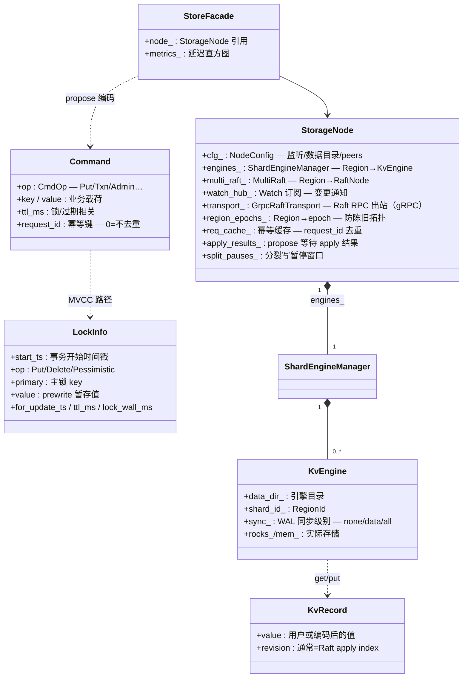
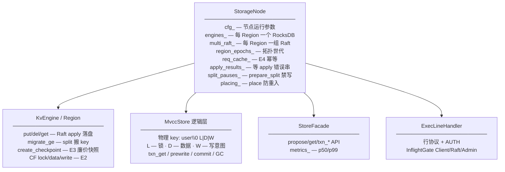
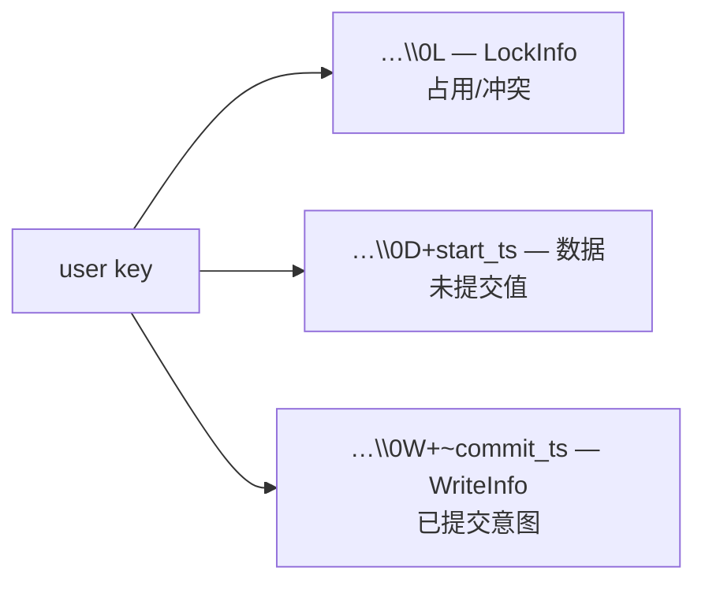

# Storage 数据拓扑结构

`StorageNode` 托管多 Region：Multi-Raft + KvEngine/MVCC + Admin/TCP。  
图例：`字段 — 含义 / 作用`  
代码：`storage/include/opskv/storage/*.hpp`

---

## 1. 总图（字段 + 含义）

---

## 2. 包含关系展开

---

## 3. 字段词典

### `StorageNode`（私有关键）

| 字段 | 含义 | 作用 |
|------|------|------|
| `cfg_` | 节点配置 | 监听、data_dir、persist_sync |
| `engines_` | 引擎管理器 | Region 数据落盘 |
| `multi_raft_` | 多 Raft | Region 共识 |
| `watch_hub_` | Watch | 订阅 key 变更 |
| `transport_` | Raft 传输 | 跨节点 AE/Vote/Snap |
| `region_epochs_` | epoch 表 | txn 校验 / Admin 递增 |
| `apply_results_` | index→error | propose 同步等待 |
| `req_cache_` / `req_order_` | 幂等记录 | 重试短路、有界淘汰 |
| `split_pauses_` | 分裂暂停 | prepare→split 间拒写 |
| `pending_peers_` | 待 ENSURE 成员 | 首次建组 |
| `auto_split_*` | 阈值 | 自动分裂/合并 |

### `Command` / `CmdOp`

| 字段/取值 | 含义 | 作用 |
|-----------|------|------|
| `op` | 操作码 | apply 分支 |
| `key` / `value` | 载荷 | KV 或编码的 txn/Admin |
| `ttl_ms` | TTL | 锁过期等 |
| `request_id` | 客户端请求号 | E4 幂等 |
| `kPrewrite`…`kCommit` | 事务 | Percolator |
| `kAdminSplit` 等 | Admin 入 Raft | 与 ConfChange 分离 |

### `KvRecord` / `LockInfo` / `WriteInfo`

| 字段 | 含义 | 作用 |
|------|------|------|
| `KvRecord.value` | 存储值 | 用户数据或编码 blob |
| `KvRecord.revision` | 版本 | 通常 Raft index |
| `LockInfo.start_ts` | 锁所属事务 | 冲突检测 |
| `LockInfo.primary` | 主锁 | 2PC / resolve |
| `LockInfo.ttl_ms` / `lock_wall_ms` | 租约 | 过期清理 |
| `WriteInfo.start_ts` / `op` | 已提交写意图 | txn_get 回溯 |

### `ProposeResult` / `GetResult` / `TxnGetResult`

| 字段 | 含义 | 作用 |
|------|------|------|
| `ok` / `found` / `locked` | 结果标志 | 客户端分支 |
| `revision` | 版本 | 回传 |
| `error` | 错误串 | locked/conflict/… |
| `redirect_to` | Leader 地址 | not_leader 重试 |
| `blocking_lock` | 挡路的锁 | 客户端 resolve |

### `InflightGate`

| 字段 | 含义 | 作用 |
|------|------|------|
| `max_[Client/Raft/Admin]` | 并发上限 | 保护 Raft 不被 Client 打满 |
| `inflight_` | 当前在途 | try_enter |
| `rejected_` | 拒绝计数 | STATS |

### `IdempotentRecord`

| 字段 | 含义 | 作用 |
|------|------|------|
| `ok` / `revision` / `error` | 首次执行结果 | 重试直接返回 |

---

## 4. MVCC 物理布局

---

## 相关

- [STORE_PRODUCTION.md](../production/STORE_PRODUCTION.md)  
- [RAFT_DATA_TOPOLOGY.md](RAFT_DATA_TOPOLOGY.md)  
- [DATA_TOPOLOGY_INDEX.md](DATA_TOPOLOGY_INDEX.md)  
